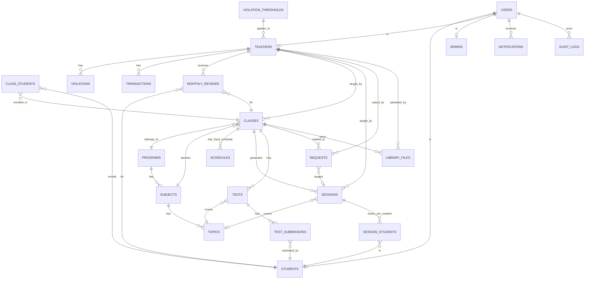

# THIẾT KẾ CƠ SỞ DỮ LIỆU (ERD)
**Dự án:** LMS MasterStudy - Trung tâm Ngoại ngữ AROMA
**Phiên bản:** 2.1 (cập nhật: sửa cardinality, bổ sung 8 bảng nghiệp vụ, thêm timestamp/index)

> [!IMPORTANT]
> **Cập nhật 2.1 — Adapt sang MySQL (xây trên source PHP/MySQL hiện tại).**
> Phiên bản 2.0 thiết kế cho PostgreSQL 15. Theo quyết định **D1**, ERD được **adapt sang
> MySQL** và triển khai trong cùng DB `phuongnamv_db` với nghiệp vụ e-commerce (D2).
>
> Thay đổi chính:
> - **Tên bảng**: thêm prefix `db_lms_` (VD `users` → `db_lms_users`) để tách khỏi các bảng
>   e-commerce (`db_sanpham`, `db_dathang`…). Tên bảng trong sơ đồ dưới đây giữ nguyên dạng
>   logic; tên vật lý = `db_lms_<tên>`.
> - **3 portal đối xứng (D3)**: cả Admin LMS / Teacher / Student đều dùng chung `db_lms_users`
>   (role ENUM admin/teacher/student) + bảng profile `db_lms_admins` / `db_lms_students` /
>   `db_lms_teachers`. `db_user` chỉ dành cho admin e-commerce, **không đụng**.
> - **Kiểu dữ liệu**: `ENUM` → `VARCHAR(30)` + validate app-level; `TIMESTAMP` → `DATETIME`;
>   `JSON` giữ nguyên (MySQL 5.7+).
> - **Partition**: ~~`sessions`/`audit_logs` partition theo tháng/quý~~ → **bỏ**, dùng
>   composite index (quy mô 1 trung tâm).
> - **Character set**: mọi bảng `utf8mb4` (học viên có tên tiếng Việt).
> - Kiểm tra version MySQL/PHP thực tế ở Phase 0.2 trước khi viết migration.
>
> **Toàn bộ cấu trúc bảng, quan hệ, index, business constraint dưới đây vẫn nguyên giá trị.**

Dưới đây là thiết kế cấu trúc Cơ sở dữ liệu cốt lõi (Core Database Schema) để đáp ứng các nghiệp vụ phức tạp của hệ thống.

## 1. SƠ ĐỒ THỰC THỂ LIÊN KẾT (ERD DIAGRAM)

Sơ đồ thể hiện mối quan hệ giữa các bảng chính trong hệ thống:

---

## 2. CẤU TRÚC CÁC BẢNG (TABLE STRUCTURES)

### 2.0. Quy ước chung cho mọi bảng

- Mọi bảng đều có 3 trường bắt buộc: `id` (PK, BIGINT auto-increment), `created_at` (TIMESTAMP DEFAULT NOW()), `updated_at` (TIMESTAMP ON UPDATE NOW()).
- Các bảng có thể soft-delete sẽ thêm `deleted_at` (TIMESTAMP NULL).
- Tất cả FK đều có index. Các cột truy vết nghiệp vụ thường xuyên đều có composite index (ghi chú ở từng bảng).
- Kiểu dữ liệu: `VARCHAR(n)`, `TEXT`, `DECIMAL(15,2)`, `DATETIME`, `JSON`, `BOOLEAN`, `ENUM(...)`.

> [!NOTE]
> **Adapt MySQL (v2.1):** Khi viết migration thực tế:
> - Kiểu dữ liệu trong ERD mang tính logic. Trên MySQL: `TIMESTAMP` → `DATETIME DEFAULT CURRENT_TIMESTAMP` / `ON UPDATE CURRENT_TIMESTAMP`; `ENUM(...)` → `VARCHAR(30)` + validate trong service layer (MySQL ENUM khó thay đổi khi đã có dữ liệu).
> - `JSON` giữ nguyên (cần MySQL 5.7+). Kiểm tra version ở Phase 0.2.
> - Engine `InnoDB`, charset `utf8mb4 COLLATE utf8mb4_unicode_ci`.
> - Tên bảng vật lý = `db_lms_<tên bảng>` (prefix tách biệt e-commerce — D2).

### 2.1. Nhóm Quản lý Tài khoản (Auth & Profiles)

**Bảng `users`** (Lưu thông tin đăng nhập chung)
- `id` (PK, BIGINT)
- `username` (VARCHAR(50) UNIQUE NOT NULL, VD: haphuong227, TE125)
- `password` (VARCHAR(255) NOT NULL - Bcrypt hash)
- `email` (VARCHAR(100) UNIQUE)
- `phone` (VARCHAR(20))
- `role` (ENUM('admin', 'teacher', 'student') NOT NULL)
- `status` (ENUM('active', 'locked', 'pending') DEFAULT 'active')
- `last_login_at` (DATETIME)
- `created_at`, `updated_at`
- **Index:** UNIQUE(`username`), INDEX(`role`, `status`)

**Bảng `students`** (Hồ sơ học viên)
- `user_id` (PK, FK -> users.id, UNIQUE)
- `student_code` (VARCHAR(20) UNIQUE, VD: Master227)
- `full_name` (VARCHAR(100) NOT NULL)
- `parent_name` (VARCHAR(100))
- `parent_phone` (VARCHAR(20))
- `grade` (VARCHAR(20), VD: "Lớp 5")
- `school_name` (VARCHAR(100))
- `district`, `ward`, `current_address` (VARCHAR)
- `learning_type` (ENUM('online', 'offline') NOT NULL)
- `priority_number` (INT - Số ưu tiên xếp lớp)
- `status` (ENUM('pending_arrange', 'waiting_fee', 'studying', 'paused', 'quit') DEFAULT 'pending_arrange')
- `free_time_slots` (JSON - Mảng các khung giờ rảnh theo ngày trong tuần)
- `created_at`, `updated_at`
- **Index:** INDEX(`status`), INDEX(`district`, `ward`)

**Bảng `teachers`** (Hồ sơ giáo viên)
- `user_id` (PK, FK -> users.id, UNIQUE)
- `teacher_code` (VARCHAR(20) UNIQUE, VD: TE125)
- `full_name` (VARCHAR(100) NOT NULL)
- `gender` (ENUM('male', 'female', 'other'))
- `dob` (DATE)
- `cccd` (VARCHAR(20) UNIQUE)
- `issue_date` (DATE), `issue_place` (VARCHAR(100))
- `tax_code` (VARCHAR(20))
- `teachable_districts` (JSON - Mảng các quận có thể dạy)
- `teachable_subjects` (JSON - Mảng subject_id có thể dạy)
- `can_teach_online` (BOOLEAN DEFAULT TRUE)
- `rank` (ENUM('bronze', 'gold', 'green') - green=ưu tiên cao nhất, gold=trung bình, bronze=mới)
- `max_classes` (INT - Số lớp tối đa được phép dạy đồng thời)
- `service_fee_percentage` (DECIMAL(5,2), VD: 48.00)
- `is_commit_08` (BOOLEAN - Cam kết thuế TNCN theo Cam kết 08)
- `bank_name`, `bank_account`, `bank_owner` (VARCHAR)
- `created_at`, `updated_at`
- **Index:** INDEX(`rank`), INDEX(`status`)

**Bảng `admins`** (Hồ sơ quản trị viên — Admin LMS, dùng portal `lms/admin.php`)
- `user_id` (PK, FK -> users.id, UNIQUE)
- `full_name` (VARCHAR(100))
- `role_level` (ENUM('super_admin', 'staff', 'viewer'))
- `permissions` (JSON - Mảng quyền cụ thể)
- `created_at`, `updated_at`

> [!NOTE]
> **Phân biệt (D3):** `db_lms_admins` dành riêng cho Admin **LMS**. Admin của phần e-commerce
> dùng `db_user` hiện có — hai hệ thống tài khoản hoàn toàn tách biệt.

### 2.2. Nhóm Quản lý Lộ trình Học (Curriculum)

**Bảng `programs`** (Nhóm chương trình - VD: Toán TĐN 1-1, Tiếng Anh)
- `id` (PK), `name` (VARCHAR(100) NOT NULL)
- `description` (TEXT)
- `created_at`, `updated_at`

**Bảng `subjects`** (Môn học/Danh mục - VD: Math Problems, Math IQ, Tiếng Anh Listening)
- `id` (PK), `program_id` (FK -> programs.id NOT NULL)
- `name` (VARCHAR(100) NOT NULL)
- `created_at`, `updated_at`
- **Index:** INDEX(`program_id`)

**Bảng `topics`** (Chuyên đề - VD: "How to calculate", "Phép cộng trừ")
- `id` (PK), `subject_id` (FK -> subjects.id NOT NULL)
- `name` (VARCHAR(150) NOT NULL)
- `has_test` (BOOLEAN DEFAULT FALSE - Chuyên đề này có bài test cuối không)
- `has_minitest` (BOOLEAN DEFAULT FALSE)
- `max_sessions` (INT - Số buổi học tối đa của chuyên đề)
- `order_index` (INT - Thứ tự trong subject)
- `report_template` (TEXT - HTML template nhận xét)
- `created_at`, `updated_at`
- **Index:** INDEX(`subject_id`, `order_index`)

### 2.3. Nhóm Quản lý Lớp học & Thời khoá biểu

**Bảng `classes`** (Lớp học)
- `id` (PK), `class_code` (VARCHAR(30) UNIQUE NOT NULL)
- `program_id` (FK -> programs.id NOT NULL)
- `subject_id` (FK -> subjects.id NOT NULL)
- `teacher_id` (FK -> teachers.user_id NOT NULL)
- `class_type` (ENUM('one_on_one', 'group') NOT NULL)
- `name` (VARCHAR(100), VD: "Toán 1-1 - Duy Kiên 1117")
- `price_per_session` (DECIMAL(15,2) - Học phí 1 buổi)
- `teacher_percentage` (DECIMAL(5,2) - % GV nhận tại lớp này, có thể ghi đè `teachers.service_fee_percentage`)
- `total_sessions` (INT - Tổng buổi cam kết của lớp)
- `remaining_sessions` (INT - Số buổi còn lại, tự động trừ khi tạo session hoàn thành)
- `hw_deadline_time` (TIME, VD: "12:00" - Hạn giao BTVN sau buổi học)
- `hw_check_hours` (INT, VD: 24 - Hạn chấm BTVN trước buổi tiếp theo)
- `status` (ENUM('arranging', 'active', 'paused', 'finished', 'cancelled') DEFAULT 'active' — `arranging` = lớp tạo từ ghép lớp, chưa xếp lịch/chưa kích hoạt)
- `start_date` (DATE), `expected_end_date` (DATE)
- `created_at`, `updated_at`, `deleted_at`
- **Index:** INDEX(`teacher_id`, `status`), INDEX(`subject_id`), INDEX(`class_type`, `status`)

**Bảng `class_students`** (Bảng trung gian n-n Lớp và Học viên)
- `id` (PK)
- `class_id` (FK -> classes.id NOT NULL)
- `student_id` (FK -> students.user_id NOT NULL)
- `enrolled_at` (DATETIME DEFAULT NOW())
- `status` (ENUM('active', 'transferred_out', 'completed') DEFAULT 'active')
- **Ràng buộc nghiệp vụ:** lớp `one_on_one` chỉ được có tối đa 1 dòng `active` (service chặn khi thêm HV); chuyển lớp giữ dòng cũ ở trạng thái `transferred_out` để bảo toàn lịch sử buổi học.
- `created_at`, `updated_at`
- **Index:** UNIQUE(`class_id`, `student_id`), INDEX(`student_id`, `status`)

**Bảng `schedules`** (Lịch học cố định hàng tuần)
- `id` (PK), `class_id` (FK -> classes.id NOT NULL)
- `day_of_week` (TINYINT - 2=Thứ 2, 3=Thứ 3, ..., 8=Chủ nhật)
- `start_time` (TIME, VD: "17:30")
- `end_time` (TIME, VD: "19:00")
- `effective_from` (DATE - Áp dụng từ ngày)
- `effective_to` (DATE NULL - Áp dụng đến ngày, NULL = vô thời hạn)
- `created_at`, `updated_at`
- **Index:** INDEX(`class_id`, `day_of_week`), INDEX(`day_of_week`, `start_time`)

### 2.4. Nhóm Quản lý Buổi học, BTVN & Bài Test

**Bảng `sessions`** (Buổi học thực tế được sinh tự động từ Schedules)
- `id` (PK), `class_id` (FK -> classes.id NOT NULL)
- `teacher_id` (FK -> teachers.user_id NOT NULL)
- `topic_id` (FK -> topics.id NULL - GV chọn khi ghi lesson summary)
- `session_date` (DATE NOT NULL)
- `start_time` (TIME), `end_time` (TIME)
- `lesson_summary` (TEXT - Nhận xét buổi học)
- `hw_content` (TEXT - Nội dung BTVN)
- `hw_deadline` (DATETIME - Hạn nộp, tính tự động = session_date + 1 ngày + classes.hw_deadline_time)
- `hw_attached_files` (JSON - Mảng file GV đính kèm)
- `status` (ENUM('upcoming', 'finished', 'cancelled', 'absent_teacher', 'absent_student') DEFAULT 'upcoming')
- `is_summary_late` (BOOLEAN DEFAULT FALSE - Cronjob đánh dấu nếu nộp summary trễ)
- `summary_submitted_at` (DATETIME NULL)
- `created_at`, `updated_at`
- **Index:** INDEX(`class_id`, `session_date`), INDEX(`teacher_id`, `session_date`), INDEX(`status`, `session_date`)
- **Partition:** ~~Nên partition theo RANGE(`session_date`) theo quý~~ → **bỏ partition (D1, v2.1)**; composite index `(teacher_id, session_date)` + `(status, session_date)` là đủ cho quy mô 1 trung tâm.

**Bảng `session_students`** (Quản lý BTVN của từng học sinh trong buổi học)
- `id` (PK)
- `session_id` (FK -> sessions.id NOT NULL)
- `student_id` (FK -> students.user_id NOT NULL)
- `hw_submission_files` (JSON - Mảng tối đa 4 file HS nộp)
- `hw_submitted_at` (DATETIME NULL)
- `hw_submission_status` (ENUM('not_submitted', 'submitted_on_time', 'submitted_late') DEFAULT 'not_submitted')
- `teacher_feedback_text` (TEXT - GV nhận xét)
- `teacher_feedback_files` (JSON - File Excel/PDF chấm điểm đính kèm)
- `hw_graded_at` (DATETIME NULL)
- `is_graded_late` (BOOLEAN DEFAULT FALSE)
- `grade` (DECIMAL(5,2) - Điểm số nếu có)
- `status` (ENUM('not_submitted', 'submitted', 'graded', 'overdue') DEFAULT 'not_submitted')
- `created_at`, `updated_at`
- **Index:** UNIQUE(`session_id`, `student_id`), INDEX(`student_id`, `status`)

**Bảng `tests`** (Quản lý các bài thi/Test/Minitest của lớp)
- `id` (PK)
- `class_id` (FK -> classes.id NOT NULL)
- `topic_id` (FK -> topics.id NOT NULL)
- `test_type` (ENUM('test', 'minitest') NOT NULL)
- `title` (VARCHAR(150))
- `test_file_url` (VARCHAR(500) - File đề thi GV upload lên)
- `deadline` (DATETIME NOT NULL)
- `max_score` (DECIMAL(5,2) DEFAULT 20.00)
- `status` (ENUM('draft', 'published', 'closed') DEFAULT 'draft')
- `created_by` (FK -> teachers.user_id)
- `created_at`, `updated_at`
- **Index:** INDEX(`class_id`, `test_type`), INDEX(`status`, `deadline`)

**Bảng `test_submissions`** (Bài làm Test của từng học viên)
- `id` (PK)
- `test_id` (FK -> tests.id NOT NULL)
- `student_id` (FK -> students.user_id NOT NULL)
- `submission_files` (JSON - File bài làm HS upload)
- `submitted_at` (DATETIME NULL)
- `submission_status` (ENUM('not_submitted', 'submitted_on_time', 'submitted_late'))
- `score_x` (DECIMAL(5,2) - Điểm X/20)
- `score_y_percent` (DECIMAL(5,2) - Phần trăm Y%)
- `graded_at` (DATETIME NULL)
- `is_graded_late` (BOOLEAN DEFAULT FALSE)
- `teacher_feedback_files` (JSON - File đã chấm GV upload)
- `created_at`, `updated_at`
- **Index:** UNIQUE(`test_id`, `student_id`), INDEX(`student_id`, `submission_status`)

### 2.5. Nhóm Nghiệp vụ Yêu cầu (Requests) - BỔ SUNG

**Bảng `requests`** (Quản lý tất cả yêu cầu từ GV/HS gửi Admin duyệt)
- `id` (PK)
- `request_type` (ENUM('add_session', 'send_test', 'change_schedule', 'request_leave', 'request_bonus', 'other') NOT NULL)
- `class_id` (FK -> classes.id NULL - Lớp liên quan)
- `session_id` (FK -> sessions.id NULL - Buổi cụ thể nếu có)
- `teacher_id` (FK -> teachers.user_id NULL - Người tạo)
- `student_id` (FK -> students.user_id NULL - HV liên quan)
- `title` (VARCHAR(200))
- `description` (TEXT)
- `payload` (JSON - Dữ liệu bổ sung tuỳ loại: lý do nghỉ, lịch mới muốn đổi,...)
- `status` (ENUM('pending', 'approved', 'rejected', 'cancelled') DEFAULT 'pending')
- `processed_by` (FK -> admins.user_id NULL)
- `processed_at` (DATETIME NULL)
- `admin_note` (TEXT)
- `created_at`, `updated_at`
- **Index:** INDEX(`request_type`, `status`), INDEX(`teacher_id`, `status`), INDEX(`class_id`)

### 2.6. Nhóm Tài chính & Vi phạm

**Bảng `violation_thresholds`** (Cấu hình ngưỡng tick theo số lớp GV đang dạy) - BỔ SUNG
- `id` (PK)
- `min_classes` (INT - Số lớp tối thiểu để áp dụng rule)
- `max_classes` (INT NULL - Số lớp tối đa, NULL = không giới hạn trên)
- `ticks_to_warn` (INT - Ngưỡng tick để cảnh báo)
- `ticks_to_demote_fee` (INT - Ngưỡng tick để hạ phí dịch vụ, VD: 8)
- `fee_percentage_after_demote` (DECIMAL(5,2) - % phí DV sau khi hạ, VD: 30.00)
- `ticks_exempted` (INT - Số tick được miễn giảm theo rule)
- `effective_from` (DATE)
- `effective_to` (DATE NULL)
- `created_at`, `updated_at`
- **Index:** INDEX(`min_classes`, `max_classes`)

**Bảng `violations`** (Quản lý Tick phạt)
- `id` (PK)
- `teacher_id` (FK -> teachers.user_id NOT NULL)
- `class_id` (FK -> classes.id NULL)
- `session_id` (FK -> sessions.id NULL)
- `tick_amount` (TINYINT - Có thể +1 (phạt) hoặc -1 (miễn giảm thủ công))
- `reason` (ENUM('late_lesson_summary', 'late_hw_grading', 'late_test_grading', 'manual_penalty', 'manual_exempt') NOT NULL)
- `note` (TEXT)
- `auto_generated` (BOOLEAN DEFAULT TRUE - TRUE: do cronjob, FALSE: do Admin tạo thủ công)
- `violation_date` (DATE)
- `created_by` (FK -> admins.user_id NULL)
- `created_at`
- **Index:** INDEX(`teacher_id`, `violation_date`), INDEX(`reason`, `violation_date`)

**Bảng `transactions`** (Quản lý Phí dịch vụ GV - Sổ cái)
- `id` (PK)
- `teacher_id` (FK -> teachers.user_id NOT NULL)
- `session_id` (FK -> sessions.id NULL - Buổi dạy phát sinh giao dịch)
- `amount` (DECIMAL(15,2) NOT NULL - Có thể âm hoặc dương)
- `type` (ENUM('salary_session', 'penalty', 'bonus', 'tax', 'deposit_deduct', 'adjustment') NOT NULL)
- `reason` (VARCHAR(255))
- `reference_id` (BIGINT NULL - FK logic tới violations/requests tuỳ type)
- `transaction_date` (DATE NOT NULL)
- `period_month` (CHAR(7) - VD: "2026-07", dùng để group theo tháng tính lương)
- `created_by` (FK -> admins.user_id NULL)
- `created_at`, `updated_at`
- **Index:** INDEX(`teacher_id`, `period_month`), INDEX(`type`, `transaction_date`)

### 2.7. Nhóm Nhận xét & Thư viện - BỔ SUNG

**Bảng `monthly_reviews`** (Nhận xét tháng của GV cho HV) - BỔ SUNG
- `id` (PK)
- `student_id` (FK -> students.user_id NOT NULL)
- `class_id` (FK -> classes.id NOT NULL)
- `teacher_id` (FK -> teachers.user_id NOT NULL)
- `review_month` (CHAR(7) - VD: "2026-08")
- `overall_rating` (ENUM('excellent', 'good', 'average', 'need_improvement'))
- `content` (TEXT NOT NULL)
- `progress_percent` (DECIMAL(5,2) - % hoàn thành lộ trình trong tháng)
- `published_at` (DATETIME)
- `created_at`, `updated_at`
- **Index:** UNIQUE(`student_id`, `class_id`, `review_month`), INDEX(`review_month`)

**Bảng `library_files`** (Thư viện tài liệu: slide, đề thi, video, audio) - BỔ SUNG
- `id` (PK)
- `class_id` (FK -> classes.id NULL - NULL = tài liệu chung)
- `uploaded_by` (FK -> teachers.user_id NOT NULL)
- `title` (VARCHAR(200))
- `file_type` (ENUM('slide', 'exam', 'video', 'audio', 'document', 'other') NOT NULL)
- `file_url` (VARCHAR(500) NOT NULL - Lưu trên Cloud Storage)
- `file_size_bytes` (BIGINT)
- `subject_id` (FK -> subjects.id NULL)
- `topic_id` (FK -> topics.id NULL)
- `description` (TEXT)
- `download_count` (INT DEFAULT 0)
- `created_at`, `updated_at`, `deleted_at`
- **Index:** INDEX(`class_id`, `file_type`), INDEX(`subject_id`)

### 2.8. Nhóm Hỗ trợ & Kiểm toán - BỔ SUNG

**Bảng `notifications`** (Thông báo cho user: cảnh báo tick, duyệt yêu cầu, lịch học) - BỔ SUNG
- `id` (PK)
- `user_id` (FK -> users.id NOT NULL)
- `type` (ENUM('tick_warning', 'request_approved', 'request_rejected', 'session_reminder', 'payment_received', 'system') NOT NULL)
- `title` (VARCHAR(200))
- `message` (TEXT)
- `link_url` (VARCHAR(500) - Link tới trang chi tiết)
- `is_read` (BOOLEAN DEFAULT FALSE)
- `read_at` (DATETIME NULL)
- `created_at`
- **Index:** INDEX(`user_id`, `is_read`, `created_at`)

**Bảng `audit_logs`** (Nhật ký kiểm toán cho mọi thao tác nhạy cảm) - BỔ SUNG
- `id` (PK)
- `actor_user_id` (FK -> users.id - Người thực hiện, NULL nếu là cronjob)
- `actor_type` (ENUM('user', 'admin', 'teacher', 'student', 'system_cron'))
- `action` (VARCHAR(100) - VD: "update_teacher_percentage", "approve_request", "add_violation")
- `target_type` (VARCHAR(50) - VD: "classes", "violations", "transactions")
- `target_id` (BIGINT)
- `before_data` (JSON NULL)
- `after_data` (JSON NULL)
- `ip_address` (VARCHAR(45))
- `user_agent` (VARCHAR(255))
- `created_at`
- **Index:** INDEX(`actor_user_id`, `created_at`), INDEX(`target_type`, `target_id`), INDEX(`action`, `created_at`)
- **Partition:** ~~Nên partition theo RANGE(`created_at`) theo tháng để tránh phình bảng~~ → **bỏ partition (D1, v2.1)**; index `(actor_user_id, created_at)` + định kỳ dọn log cũ.

---

## 3. GHI CHÚ THIẾT KẾ

1. **Quy tắc cascade:** Khi xoá `classes` → cascade soft-delete `sessions`, `class_students`, `schedules`. Không xoá vật lý `transactions`/`violations` (dùng `deleted_at`).
2. **Tính toán phí dịch vụ** chạy qua ~~stored procedure hoặc~~ job cuối tháng: tính trong `PayrollService` (PHP), query tổng sessions finished theo `period_month` × `teacher_percentage` × `price_per_session` - tax theo `is_commit_08`. Luôn có PHPUnit test (R5).
3. **Cronjob quét tick** chạy mỗi 15 phút: quét sessions quá hạn summary, session_students quá hạn chấm → insert vào `violations` với `auto_generated=TRUE`. Chạy bằng **PHP CLI qua crontab/Task Scheduler (D5)**, idempotent (UNIQUE + check-before-insert), ghi vào `db_lms_cron_runs`.
4. **Bảng `requests`** thay thế các bảng riêng lẻ (request_leave, request_change_schedule,...) - dùng `request_type` + `payload` JSON để linh hoạt.
5. **Soft delete** áp dụng cho: classes, schedules, sessions, library_files, users (khoá tài khoản thay vì xoá).
6. **Idempotency tick (R1):** UNIQUE `(teacher_id, session_id, reason, DATE(violation_date))` để cron chạy lại không tạo duplicate tick.
7. **Mọi migration** là file SQL forward-only trong `database/migrations/YYYY_MM_DD_lms_*.sql`, chạy thử trên bản copy `phuongnamv_db` trước.
8. **Cô lập e-commerce (D2+R9):** không ALTER/xoá bất kỳ bảng `db_*` e-commerce nào. Mọi bảng
   LMS dùng prefix `db_lms_`. Kiểm tra `git diff` chỉ thêm mới, không đụng schema cũ.
