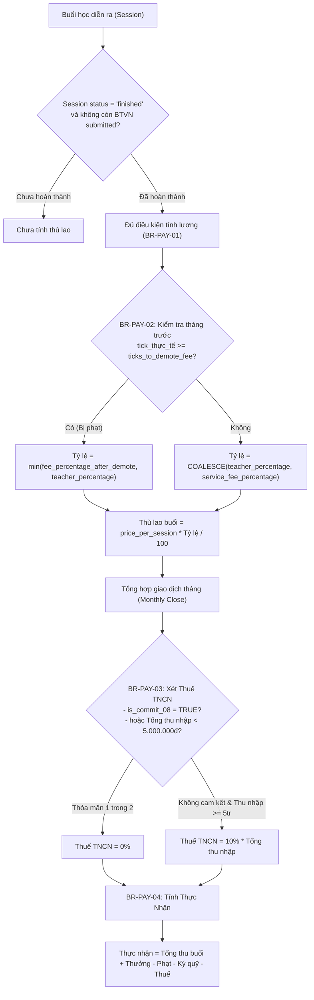
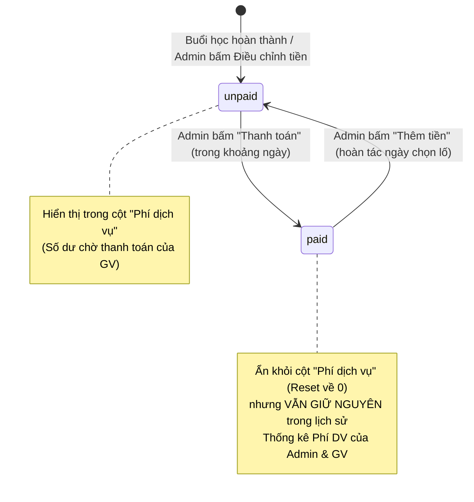
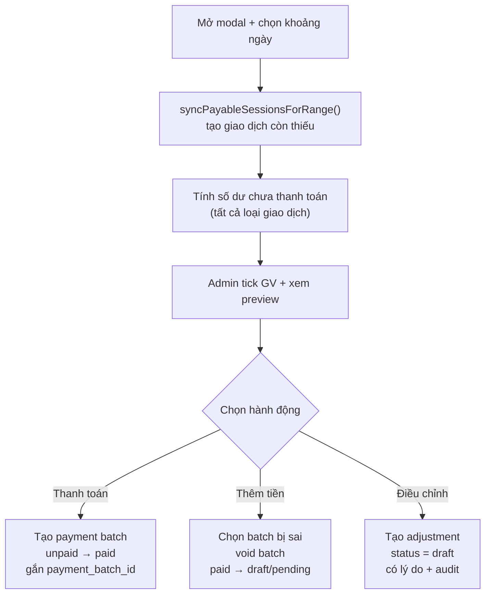

# TÀI LIỆU PHÂN TÍCH NGHIỆP VỤ: PHÍ DỊCH VỤ & QUẢN LÝ LƯƠNG GIÁO VIÊN (PAYROLL)

> **Mã tài liệu:** LMS-ANALYSIS-PAYROLL  
> **Dự án:** LMS MasterStudy (Gia sư / Quản lý trung tâm đào tạo)  
> **Ngày lập:** 08/11/2026  
> **Trạng thái:** Tài liệu nghiệp vụ & Thiết kế kỹ thuật  

---

## 1. TỔNG QUAN & BẢN CHẤT NGHIỆP VỤ CỦA "PHÍ DỊCH VỤ"

### 1.1. Bản chất thuật ngữ "Phí dịch vụ" trong hệ thống
Trong mô hình hoạt động của MasterStudy:
* **Trung tâm** đóng vai trò là đơn vị quản lý, điều phối lớp học, kiểm soát chất lượng giảng dạy và thu học phí từ học viên/phụ huynh.
* **Giáo viên** cung cấp dịch vụ giảng dạy theo hợp đồng/thỏa thuận hợp tác.
* **"Phí dịch vụ" (Service Fee)** trong toàn bộ hệ thống thực chất là **Thù lao giảng dạy / Lương của Giáo viên (Teacher Payroll)** được chi trả từ trung tâm khi giáo viên hoàn thành nhiệm vụ giảng dạy các buổi học.
* Thuật ngữ này được dùng từ góc độ pháp lý và kế toán: *Giáo viên cung cấp dịch vụ đào tạo và nhận phí dịch vụ từ trung tâm*. Trên giao diện và tài liệu kỹ thuật, "Phí dịch vụ" đồng nghĩa với **Lương / Thù lao giáo viên**.

### 1.2. Cơ chế phân chia thù lao
* Mỗi buổi học có một mức đơn giá học phí (`price_per_session`).
* Khi buổi học hoàn tất và đạt chuẩn chất lượng (đã nộp báo cáo buổi dạy và chấm bài đúng hạn), giáo viên được nhận một tỷ lệ phần trăm (%) trên học phí của buổi đó (ví dụ: `48%` của `560.000đ` = `268.800đ`).
* Thù lao các buổi học trong tháng được tổng hợp lại, sau đó cộng các khoản thưởng/bù trừ, trừ đi các khoản phạt vi phạm nội quy, ký quỹ và khấu trừ thuế TNCN để ra **tiền thực nhận**.

---

## 2. PHÂN TÍCH CHI TIẾT CÁC MÀN HÌNH & TRƯỜNG DỮ LIỆU

### 2.1. Màn hình Thêm / Sửa Giáo viên
* **URL:** `http://source.test:81/lms/admin/lms-tai-khoan/them-giao-vien` và `.../sua-giao-vien?id=...`
* **File template:** `lms/app/admin/templates/lms-giao-vien/form_tpl.php`
* **File controller/source:** `lms/app/admin/sources/lms-tai-khoan.php`, `lms/services/Lms/UserService.php`

| Tên trường trên UI | Tên cột CSDL / Field | Kiểu dữ liệu / Hành vi | Ý nghĩa nghiệp vụ |
| :--- | :--- | :--- | :--- |
| **Mức phí DV** | `teachers.service_fee_percentage` | `DECIMAL(5,2)`, mặc định `48.00` (step 0.5%) | Là **tỷ lệ phần trăm thù lao cơ sở (baseline)** mà giáo viên được nhận theo thỏa thuận ban đầu. Giá trị này dùng làm tỷ lệ mặc định tự động điền khi gán giáo viên vào bất kỳ lớp học mới nào. |
| **Phí dịch vụ** | Biến tính toán `month_fee` | `DECIMAL(15,2)`, `readonly`, suffix `đồng` | Là **tổng tiền thù lao giáo viên đã tích lũy trong tháng hiện tại**. Hệ thống tính bằng `SELECT COALESCE(SUM(amount), 0) FROM db_lms_transactions WHERE teacher_id = ? AND period_month = 'YYYY-MM'`. Giúp Admin xem nhanh thu nhập tháng này của GV khi tra cứu hồ sơ. |
| **Cam kết 08** | `teachers.is_commit_08` | `BOOLEAN`, mặc định `0` (Không) | Đăng ký cam kết thuế TNCN mẫu 08: nếu có cam kết thì thuế TNCN = 0%; nếu không cam kết và thu nhập tháng $\ge$ 5.000.000đ thì khấu trừ 10%. |
| **Số tick tháng này** | Biến tính toán `month_ticks` | `INT`, `readonly`, suffix `tick` | Tổng số tick vi phạm chất lượng trong tháng hiện tại của GV (dùng để cảnh báo và xét hạ mức phí dịch vụ ở tháng kế tiếp). |

---

### 2.2. Nút "Thanh toán phí dịch vụ" & Danh sách Giáo viên
* **URL:** `http://source.test:81/lms/admin/lms-tai-khoan/man?tab=giao-vien`
* **File template:** `lms/app/admin/templates/lms-tai-khoan/hienthi_tpl.php`
* **Mockup thiết kế chuẩn:** `Tai-lieu-phat-trien/admin/Phí DV GV.png`

#### Hiện trạng mã nguồn:
* Nút *"Thanh toán phí dịch vụ"* đang đóng vai trò là một liên kết chuyển hướng nhanh sang module thống kê phí dịch vụ (`href => lms_url('lms-phi-dv')`).
* Cột "Phí dịch vụ" trên bảng danh sách giáo viên hiện đang hiển thị số tiền tĩnh hardcode (`1,468,800 đ`).

#### Nghiệp vụ thực tế cần xây dựng theo mockup `Phí DV GV.png`:
Nút này sẽ kích hoạt một Popup Modal hỗ trợ thao tác nghiệp vụ kế toán nhanh/hàng loạt cho nhiều giáo viên cùng lúc:

1. **Khối 1: Bảng chọn danh sách giáo viên cần thanh toán**
   * Ô tìm kiếm nội dung trong bảng (`tìm nội dung trong bảng`).
   * Bảng danh sách gồm 4 cột:
     * *Họ và tên* (kèm nhãn Hạng: Vàng / Xanh / Đồng).
     * *Mã GV* (ví dụ: `TE125`).
     * *Phí dịch vụ* (số tiền thù lao tích lũy hiện tại của GV, ví dụ: `1,468,800 đ`).
     * *Chọn* (Checkbox chọn từng GV và nút *Chọn tất cả*).
   * Phân trang danh sách giáo viên.

2. **Khối 2: Thanh toán theo buổi học / khoảng thời gian**
   * **Thanh toán các buổi:** Cho phép chọn `[Từ ngày] → [Đến ngày]` và bấm nút `[Thanh toán]`. Hành động này sẽ chốt quyết toán / chuyển trạng thái thanh toán thù lao cho các buổi dạy diễn ra trong khoảng thời gian này của các giáo viên đã được tick chọn.
   * **Cộng lại các buổi:** Cho phép chọn `[Từ ngày] → [Đến ngày]` và bấm nút `[Thêm tiền]`. Dùng cho nghiệp vụ kế toán cần tính bù, cộng dồn bổ sung các buổi học trước đó bị sót tiền cho giáo viên.

3. **Khối 3: Điều chỉnh số tiền cụ thể (Manual Adjustment)**
   * Input nhập số tiền có dấu: hỗ trợ nhập số dương hoặc số âm (ví dụ: `+100000`, `-100000`, ...).
   * Input nhập lý do: `Ghi nội dung điều chỉnh tiền tại đây....`
   * Nút `[Điều chỉnh tiền]`: Áp dụng khoản phạt/thưởng/bù trừ này trực tiếp vào tài khoản thù lao của toàn bộ các giáo viên đang được chọn (sinh bản ghi trong `db_lms_transactions`).

#### Giải đáp logic hiển thị: Mỗi dòng trong Popup là 1 Giáo viên hay 1 Lớp học?
* **Khẳng định:** Mỗi dòng trong popup đại diện cho **MỘT GIÁO VIÊN**, và cột "Phí dịch vụ" là **TỔNG số tiền giáo viên đó nhận được từ TẤT CẢ các lớp mà họ đang dạy** (chứ không phải mỗi dòng là 1 lớp).
* **Bằng chứng thiết kế & nghiệp vụ:**
  1. **Dữ liệu trên dòng (`Phí DV GV.png`):** Cột 1 hiển thị tên kèm *"Hạng: Vàng"* (`teachers.rank` — thuộc tính riêng của Giáo viên, lớp học không có hạng). Cột 2 hiển thị mã `TE125` (`TE` = Teacher, khác với mã lớp `TDN...` hoặc `CL...`). Cột 3 hiển thị `1,468,800 đ` khớp 100% với cột "Phí dịch vụ" của giáo viên ở bảng nền phía sau.
  2. **Ngữ cảnh màn hình:** Nút mở popup nằm tại trang *Quản lý tài khoản $\rightarrow$ Tab Giáo viên*, đối tượng quản trị là từng nhân sự giáo viên.
  3. **Nghiệp vụ thanh toán & Thuế TNCN:** Khi chi trả lương, kế toán chuyển khoản 1 lần vào **1 số tài khoản ngân hàng duy nhất** của giáo viên đó. Đồng thời, điều kiện khấu trừ 10% Thuế TNCN (`BR-PAY-03`, tổng thu nhập $\ge 5.000.000\text{ đ}$) bắt buộc phải tính trên **tổng thu nhập gộp tất cả các lớp** của cá nhân giáo viên, không thể tách lẻ từng lớp.
  4. **Tra cứu chi tiết từng lớp:** Khi kế toán muốn xem giáo viên đó dạy những lớp nào, mỗi buổi được bao nhiêu tiền, kế toán sẽ xem tại trang **Thống kê phí dịch vụ (`admin/lms-phi-dv`)** (mockup `Thống kê phí dịch vụ - Có dữ liệu.png`).

#### Ghi chú (Note) nghiệp vụ thực tế từ Khách hàng cho 3 nút trong Popup:
* **Nút `"Thanh toán"`:** Dùng để trừ phí dịch vụ trong khoảng thời gian được chọn ($\rightarrow$ để **Reset phí dịch vụ của GV về 0** khi bắt đầu tháng mới).
* **Nút `"Thêm tiền"`:** Dùng trong trường hợp nút *Thanh toán* bên trên chọn sai ngày (xóa lố phí dịch vụ sang ngày của tháng mới) thì chọn khoảng ngày bị lố để **cộng bù lại các buổi học** trong ngày bị xóa lố.
* **Nút `"Điều chỉnh tiền"`:** Dùng trong trường hợp khách hàng muốn **tự điều chỉnh riêng phí dịch vụ của GV** (thưởng nóng, phạt riêng, ứng lương...), không liên quan tới phí của các buổi học.

---

### 2.3. Màn hình Tạo Lớp học
* **URL:** `http://source.test:81/lms/admin/lms-lop/them`
* **File template:** `lms/app/admin/templates/lms-lop/form_tpl.php`
* **File controller/source:** `lms/app/admin/sources/lms-lop.php`

| Tên trường trên UI | Tên cột CSDL / Field | Kiểu dữ liệu / Hành vi | Ý nghĩa nghiệp vụ |
| :--- | :--- | :--- | :--- |
| **Học phí 1 buổi** | `classes.price_per_session` | `DECIMAL(15,2)`, bắt buộc, step `1000`, suffix `đồng` | Đơn giá học phí của một buổi học mà học viên phải chi trả (ví dụ: `560,000 đồng`). |
| **Phần trăm gv nhận** | `classes.teacher_percentage` | `DECIMAL(5,2)`, bắt buộc, step `0.5%`, suffix `%` | Tỷ lệ phần trăm học phí mà giáo viên trực tiếp nhận được cho **chính lớp học này**. |

#### Mối quan hệ tương tác giữa Lớp học và Giáo viên:
* Khi Admin mở form tạo lớp và chọn một Giáo viên phụ trách, JavaScript phía client sẽ tra cứu mảng `teacherFees` và tự động điền `service_fee_percentage` mặc định của giáo viên đó vào ô "Phần trăm gv nhận".
* **Quyền ghi đè (Override):** Admin có toàn quyền chỉnh sửa lại tỷ lệ này theo đặc thù của từng lớp (ví dụ: lớp đặc biệt, lớp di chuyển xa nâng lên 50%; lớp trợ giảng giảm còn 45%). Tỷ lệ này lưu trực tiếp vào bản ghi `db_lms_classes.teacher_percentage` và **hoàn toàn không làm thay đổi** tỷ lệ gốc trong tài khoản của giáo viên.
* Trên giao diện sửa lớp có nút hỗ trợ: *"Lấy mặc định GV"* để admin nhanh chóng khôi phục lại tỷ lệ cơ sở của giáo viên.

---

### 2.4. Module Quản lý Phí DV của Admin
* **URL:** `http://source.test:81/lms/admin/lms-phi-dv`
* **File source:** `lms/app/admin/sources/lms-phi-dv.php`
* **File templates:** `hienthi_tpl.php`, `chitiet_tpl.php`
* **Service:** `lms/services/Lms/PayrollService.php`

Module này là trung tâm đối soát, thẩm định và duyệt chi thù lao của Ban quản trị:

1. **Tra cứu & Quyết toán theo Giáo viên & Khoảng thời gian:**
   * Tìm kiếm theo mã giáo viên (`teacher_code`) và khoảng ngày (`date_from` $\rightarrow$ `date_to`).
   * Hiển thị bảng tổng hợp tài chính của GV:
     * **Tổng thu:** Tổng tiền tích lũy từ các buổi dạy + thưởng + điều chỉnh dương.
     * **Ký quỹ:** Khoản trừ ký quỹ hợp đồng (`deposit_deduct`).
     * **Vi phạm:** Tổng tiền phạt từ các vi phạm nội quy (`penalty`).
     * **Phí DV cộng thêm:** Tiền thưởng (`bonus`) hoặc điều chỉnh thủ công (`adjustment`).
     * **Thuế (có điều kiện xét):** Tỷ lệ thuế áp dụng (0% hoặc 10% theo quy tắc Cam kết 08 và ngưỡng 5.000.000đ).
     * **Thực nhận:** Số tiền cuối cùng trung tâm cần chuyển khoản cho giáo viên.
2. **Xuất báo cáo tài chính:**
   * *Xuất tất cả phí dịch vụ:* Xuất CSV chuẩn Excel (UTF-8 có BOM) toàn bộ giáo viên có phát sinh giao dịch trong kỳ.
   * *Xuất file phí dịch vụ:* Chi tiết các dòng giao dịch của riêng giáo viên đang tra cứu.
   * *Xuất file số buổi dạy:* Báo cáo chấm công số buổi dạy hoàn thành của giáo viên.
3. **Quy trình Duyệt lương tháng (`action=chi-tiet`):**
   * Áp dụng chu trình duyệt 3 trạng thái:
     $$\text{Draft (Bản nháp)} \longrightarrow \text{Pending (Gửi duyệt)} \longrightarrow \text{Paid (Đã thanh toán)}$$
   * Cho phép Admin nhập bổ sung các khoản điều chỉnh thủ công riêng lẻ:
     * *Phạt (trừ tiền)* $\rightarrow$ sinh type `penalty`.
     * *Thưởng (cộng tiền)* $\rightarrow$ sinh type `bonus`.
     * *Điều chỉnh (giữ dấu)* $\rightarrow$ sinh type `adjustment`.

---

### 2.5. Module Phí DV của Giáo viên
* **URL:** `http://source.test:81/lms/teacher/lms-phi-dv`
* **File source:** `lms/app/teacher/sources/lms-phi-dv.php`
* **File template:** `lms/app/teacher/templates/lms-phi-dv/hienthi_tpl.php`

Là cổng thông tin minh bạch tài chính dành cho giáo viên:
1. **Bảo mật dòng (Row-level security):** Giáo viên chỉ xem được duy nhất dữ liệu giao dịch của chính mình (`teacher_id = current_user.id`).
2. **Bộ lọc đa chiều:** Lọc theo khoảng ngày (mặc định tháng trước) và lọc theo từng học viên (chỉ những học viên đang học các lớp của giáo viên này).
3. **Hiển thị minh bạch:**
   * Ô lớn nổi bật: **Tổng tiền thực nhận** (VND) khớp 100% với công thức quyết toán của Admin.
   * Bảng chi tiết từng giao dịch: Ngày giờ, Tên học viên (nếu lớp 1-1) hoặc Tên lớp (nếu lớp nhóm), Số tiền nhận được kèm thông báo diễn giải rõ ràng (ví dụ: *"Bạn đã nhận được 268,800 đ khi đã hoàn thành bài học cho Lớp Toán 1-1 - Duy Kiên"*).
4. **Cảnh báo hạ phí dịch vụ (BR-TICK-03):**
   * Nếu số tick vi phạm nội quy trong tháng chạm ngưỡng cảnh báo, hệ thống hiển thị banner màu đỏ cảnh báo giáo viên:
     > *"Bạn đang ở mức X tick vi phạm — đã vượt ngưỡng Y, % phí dịch vụ sẽ bị hạ tháng sau. Hãy chấm bài đúng hạn để giảm tick."*

---

## 3. CÁC QUY TẮC NGHIỆP VỤ (BUSINESS RULES - BR)



### BR-PAY-01: Điều kiện tính thù lao buổi dạy
* Một buổi học chỉ được tính tiền khi thỏa mãn 2 điều kiện đồng thời:
  1. Trạng thái buổi học `sessions.status = 'finished'`.
  2. Toàn bộ học viên trong buổi đã được giáo viên chấm xong bài (không còn bản ghi `session_students.status = 'submitted'`).
* **Công thức cơ sở:**
  $$\text{Thu nhập buổi} = \text{classes.price\_per\_session} \times \frac{\text{COALESCE}(\text{classes.teacher\_percentage}, \text{teachers.service\_fee\_percentage})}{100}$$

### BR-PAY-02: Điều chỉnh giảm % thù lao do vi phạm (Hạ phí dịch vụ)
* Hệ thống tính `tick_thực_tế` tháng trước của giáo viên:
  $$\text{tick\_thực\_tế} = \sum (\text{violations.tick\_amount}) - \text{violation\_thresholds.ticks\_exempted}$$
* Nếu `tick_thực_tế` $\ge$ `ticks_to_demote_fee` thì toàn bộ các buổi dạy trong tháng tính lương kế tiếp sẽ bị hạ tỷ lệ thù lao xuống `fee_percentage_after_demote` (ví dụ: bị hạ từ 48% xuống còn 40%).
* **Nguyên tắc an toàn:** Tỷ lệ hạ phí không bao giờ được phép cao hơn tỷ lệ hiện hành:
  $$\text{Tỷ lệ áp dụng} = \min(\text{fee\_percentage\_after\_demote}, \text{Tỷ lệ hiện hành})$$

### BR-PAY-03: Khấu trừ Thuế Thu nhập Cá nhân (TNCN)
* **Trường hợp 1 (Miễn thuế):** Giáo viên có ký Cam kết 08 (`teachers.is_commit_08 = TRUE`) $\rightarrow$ Thuế suất = $0\%$.
* **Trường hợp 2 (Khấu trừ tại nguồn 10%):** Giáo viên không ký Cam kết 08 (`is_commit_08 = FALSE`) VÀ tổng thu nhập trong tháng $\ge 5.000.000\text{ đ}$ $\rightarrow$ Thuế suất = $10\%$ tính trên tổng thu nhập.
* **Trường hợp 3 (Dưới ngưỡng):** Giáo viên không ký Cam kết 08 nhưng tổng thu nhập trong tháng $< 5.000.000\text{ đ}$ $\rightarrow$ Thuế suất = $0\%$.

### BR-PAY-04: Công thức tính tiền thực nhận (Net Salary)
$$\text{Tiền thực nhận} = \text{Tổng thu buổi dạy} + \text{Thưởng} + \text{Điều chỉnh cộng} - \text{Phạt vi phạm} - \text{Trừ ký quỹ} - \text{Thuế TNCN}$$
Trong đó:
* Các khoản tiền được hạch toán qua bảng `db_lms_transactions` với các loại `type`:
  * `salary_session`: Thù lao buổi học.
  * `bonus`: Khen thưởng / cộng thêm.
  * `penalty`: Phạt vi phạm nghiệp vụ.
  * `deposit_deduct`: Trừ tiền cọc/ký quỹ hợp đồng.
  * `tax`: Thuế TNCN khấu trừ.
  * `adjustment`: Điều chỉnh số dư thủ công.

---

## 4. TƯ DUY PHẢN BIỆN & ĐÁNH GIÁ RỦI RO KỸ THUẬT (CRITICAL THINKING)

### 4.1. Phân tích Tư duy Vận hành (Mental Model) của Khách hàng
Qua ghi chú của khách hàng về 3 nút chức năng trong Popup (`Phí DV GV.png`), có thể thấy khách hàng đang hình dung cột **"Phí dịch vụ"** giống như một **Ví số dư chờ thanh toán (Unpaid Wallet Balance)** của từng giáo viên:
* Cứ mỗi khi giáo viên dạy xong buổi học, tiền thù lao tự động cộng dồn vào ví này.
* Cuối tháng khi trung tâm chuyển khoản trả lương xong, Admin vào bấm nút **"Thanh toán"** (chọn khoảng ngày của tháng đó) $\rightarrow$ Hệ thống trừ tiền các buổi đã trả ra khỏi ví (đưa số dư ví về `0` khi bước sang tháng mới).
* Nếu lỡ tay chọn lố ngày khi bấm *Thanh toán* (làm trừ mất tiền của những buổi đầu tháng mới), Admin dùng nút **"Thêm tiền"** để cộng bù lại tiền của các buổi trong những ngày bị xóa lố.
* Nếu có thưởng nóng hoặc phạt riêng ngoài buổi học, Admin dùng nút **"Điều chỉnh tiền"** để cộng/trừ trực tiếp vào ví của giáo viên.

Tuy nhiên, nếu lập trình viên hiện thực hóa theo đúng nghĩa đen câu chữ của khách hàng (*"xóa/trừ phí"* và *"cộng bù lại"*), hệ thống sẽ gặp **5 rủi ro kỹ thuật và kế toán nghiêm trọng** dưới đây.

---

### 4.2. Giả định & Rủi ro khi triển khai Popup `Phí DV GV.png`

#### Rủi ro 1: Hiểu nhầm giữa "Reset số dư hiển thị về 0" và "Xóa/Trừ mất dữ liệu lịch sử"
* **Giả định ngầm của khách:** Bấm *"Thanh toán"* là xóa hoặc trừ mất phí dịch vụ trong khoảng ngày đó để số dư về 0.
* **Hậu quả kỹ thuật:** Hệ thống còn có 2 module báo cáo đối soát là **Thống kê phí dịch vụ của Admin (`admin/lms-phi-dv`)** và **Phí dịch vụ của Giáo viên (`teacher/lms-phi-dv`)**. Nếu nút *"Thanh toán"* thực sự xóa bản ghi (`DELETE`) hoặc chèn một giao dịch âm (`-Số tiền`) đè vào sổ cái:
  * Khi Giáo viên vào xem bảng lương tháng 8 của mình, họ sẽ thấy **Tổng tiền = 0 đ** (vì đã bị trừ hết khi Admin bấm thanh toán), khiến giáo viên không biết tháng đó mình thực nhận bao nhiêu và mất khả năng đối soát.
  * Khi Admin cần tra cứu lại hoặc xuất file CSV báo cáo phí dịch vụ của các tháng cũ, dữ liệu sẽ bị mất hoặc bằng 0.

#### Rủi ro 2: Nguy cơ "Cộng trùng / Trừ trùng tiền" (Double Counting) ở nút "Thanh toán" và "Thêm tiền"
* **Tình huống 1 (Trừ 2 lần):** Kế toán bấm *"Thanh toán"* cho khoảng ngày `01/08 -> 31/08`. Ngày hôm sau, một kế toán khác (hoặc chính người đó quên) lại chọn `15/08 -> 31/08` và bấm *"Thanh toán"* lần nữa. Nếu hệ thống chỉ tính tổng tiền buổi học trong khoảng ngày đó rồi trừ đi, giáo viên sẽ bị **trừ tiền 2 lần** cho cùng một buổi học (số dư bị âm).
* **Tình huống 2 (Cộng lố ở nút "Thêm tiền"):** Nút *"Thêm tiền"* dùng để khôi phục các buổi bị bấm thanh toán lố ngày (ví dụ lỡ thanh toán lố sang ngày `01/09 -> 05/09`). Nhưng nếu các buổi từ `01/09 -> 05/09` **chưa từng bị thanh toán lố** mà Admin vẫn bấm *"Thêm tiền"*, hoặc bấm *"Thêm tiền"* **2 lần liên tiếp**, giáo viên sẽ được **nhân đôi, nhân ba** số tiền của các buổi học đó.

#### Rủi ro 3: Các khoản "Điều chỉnh tiền" sẽ làm số dư KHÔNG THỂ về 0
* Nút *"Thanh toán"* và *"Thêm tiền"* của khách hàng đang dựa trên việc **quét các buổi học** trong khoảng ngày `[Từ ngày] -> [Đến ngày]`.
* Trong khi đó, nút **"Điều chỉnh tiền"** (`+100.000`, `-100.000`) khách hàng xác định là *"không liên quan tới phí các buổi học"*.
* **Trường hợp biên (Edge case):** Giả sử tháng 8 giáo viên dạy 10 buổi được `2.000.000 đ`, và được Admin bấm *"Điều chỉnh tiền"* thưởng thêm `+200.000 đ` $\rightarrow$ Tổng cột Phí dịch vụ là `2.200.000 đ`. Cuối tháng, Admin chọn `01/08 -> 31/08` và bấm *"Thanh toán các buổi"*. Nếu hệ thống chỉ trừ tiền của **10 buổi học** (`2.000.000 đ`), thì số dư Phí dịch vụ của giáo viên **sẽ còn treo lại `200.000 đ` mãi mãi** mà không bao giờ reset về 0 được!

#### Rủi ro 4: Sự lệch pha với Code hiện tại (`PayrollService`) và Xung đột chu kỳ tính thuế
* **Lệch thời điểm ghi nhận:** Code hiện tại trong `PayrollService` thiết kế theo hướng cuối tháng chạy Cronjob (`closeMonth`) mới sinh giao dịch tiền buổi học. Nhưng theo mô tả của khách hàng, cột "Phí dịch vụ" phải luôn hiển thị số tiền tích lũy sẵn (real-time ngay khi buổi học hoàn thành) để Admin nhìn vào đó bấm Thanh toán hoặc Điều chỉnh bất cứ lúc nào.
* **Chu kỳ tính thuế TNCN & Hạ phí (`BR-PAY-02`, `BR-PAY-03`):** Sổ cái `db_lms_transactions` quản lý giao dịch theo `period_month` (`YYYY-MM`). Việc xét thuế TNCN (ngưỡng 5 triệu/tháng) và xét hạ phí dịch vụ theo tick đều tính theo tháng dương lịch. Do đó mỗi giao dịch phát sinh bắt buộc phải gắn với `period_month` tương ứng với ngày diễn ra.

#### Rủi ro 5: Dữ liệu hardcode tại bảng danh sách tài khoản giáo viên
* **Hiện tượng:** Cột "Phí dịch vụ" trong bảng danh sách giáo viên (`lms-tai-khoan/man?tab=giao-vien`) đang hiển thị tĩnh `1,468,800 đ`.
* **Khắc phục:** Cần bổ sung việc lấy số dư phí dịch vụ chưa thanh toán động từ hàm `UserService::listTeachers()`.

---

### 4.3. Phương án thay thế & Giải pháp Kiến trúc

Để **giữ nguyên 100% giao diện và trải nghiệm bấm nút như khách hàng mong muốn**, nhưng triệt tiêu toàn bộ 5 rủi ro trên, dưới đây là 2 phương án xử lý ở tầng Database/Backend:

#### Phương án A (Khuyến nghị): Quản lý bằng trạng thái `unpaid` (Chờ thanh toán) và `paid` (Đã thanh toán) trên từng giao dịch



Thay vì xóa dữ liệu hay cộng/trừ mù quáng vào một con số tổng:
1. **Ghi nhận tự động (Real-time / Derived):** Ngay khi buổi học hoàn thành (và chấm xong BTVN), hệ thống ghi nhận khoản thù lao buổi học đó vào `db_lms_transactions` với trạng thái **`unpaid` (hoặc `draft`/`pending` = Chưa thanh toán)**.
2. **Hiển thị cột "Phí dịch vụ":** Cột "Phí dịch vụ" ở danh sách GV và trong Popup chỉ tính `SUM(amount)` của các giao dịch (gồm cả buổi học và các khoản điều chỉnh riêng) đang có trạng thái **Chưa thanh toán (`status != 'paid'`)**.
3. **Nút `"Thanh toán"` (`Từ ngày -> Đến ngày`):**
   * Chuyển toàn bộ các giao dịch buổi học (**và cả các khoản Điều chỉnh tiền**) của các GV được chọn có `transaction_date` nằm trong khoảng đã chọn từ trạng thái **`unpaid` $\rightarrow$ `paid`**.
   * **Hiệu ứng trên màn hình:** Số tiền của các ngày đó lập tức biến mất khỏi cột "Phí dịch vụ" (Reset về 0 đúng ý khách hàng).
   * **An toàn tuyệt đối (Idempotent):** Bấm thanh toán 10 lần cho cùng 1 khoảng ngày cũng không bao giờ bị trừ âm 2 lần. Lịch sử bên trang *Thống kê phí dịch vụ* của Admin và GV vẫn còn nguyên vẹn 100% để tra cứu và xuất Excel.
4. **Nút `"Thêm tiền"` (`Từ ngày -> Đến ngày`):**
   * Bản chất kỹ thuật là **Hoàn tác thanh toán (Unpay / Revert)**: Hệ thống tìm các giao dịch buổi học trong khoảng ngày bị chọn lố đang có trạng thái **`paid`** và đổi ngược về lại **`unpaid`**.
   * **Hiệu ứng trên màn hình:** Tiền của các buổi bị xóa lố lập tức xuất hiện trở lại trong cột "Phí dịch vụ" của GV.
   * **An toàn tuyệt đối:** Chỉ những buổi đã lỡ bị chuyển sang `paid` mới được cộng trả lại. Nếu buổi học vốn chưa thanh toán hoặc Admin lỡ bấm *"Thêm tiền"* 2 lần liên tiếp, tiền cũng **không bao giờ bị cộng gấp đôi**.
5. **Nút `"Điều chỉnh tiền"` (`+100000`, `-100000`):**
   * Tạo 1 dòng giao dịch `type = 'adjustment'` (hoặc `bonus` nếu dương, `penalty` nếu âm, không gắn `session_id`), lấy `transaction_date` là ngày hiện tại (hoặc ngày Admin chọn), trạng thái là **`unpaid`**.
   * Khi cuối tháng Admin bấm *"Thanh toán"* cho khoảng ngày của tháng đó, hệ thống chuyển luôn các khoản điều chỉnh `unpaid` trong kỳ sang `paid` $\rightarrow$ Đảm bảo số dư của GV **reset sạch về 0**.

#### Phương án B: Cộng/Trừ trực tiếp vào cột số dư (`teachers.balance`) không kiểm soát trạng thái buổi
* Bấm *"Thanh toán"* thì quét các buổi học trong khoảng ngày rồi trừ thẳng vào cột `balance`. Bấm *"Thêm tiền"* thì quét các buổi học trong khoảng ngày rồi cộng thẳng vào `balance`.
* **Nhược điểm:** Dễ phát sinh bug **cộng trùng / trừ trùng** khi người dùng thao tác nhầm khoảng ngày nhiều lần, và làm lệch hoàn toàn số liệu so với trang Thống kê phí dịch vụ (`lms-phi-dv`).

---

### 4.4. Khuyến nghị Chốt Thiết kế

1. **Giữ nguyên 100% giao diện & thao tác của khách hàng:** Đáp ứng đúng 3 nút (*Thanh toán để đưa về 0*, *Thêm tiền để khôi phục ngày chọn lố*, *Điều chỉnh tiền để cộng/trừ riêng*).
2. **Áp dụng Phương án A ở tầng Backend:** Sử dụng cơ chế chuyển đổi trạng thái `status` (`draft`/`pending` $\leftrightarrow$ `paid`) trong bảng `db_lms_transactions` thay vì xóa bản ghi hay cộng/trừ số học thuần túy.
3. **Đồng bộ các khoản Điều chỉnh tiền vào luồng Thanh toán:** Khi bấm *"Thanh toán"* cho khoảng ngày $T_1 \rightarrow T_2$, tất toán luôn cả các khoản *Điều chỉnh tiền* có ngày phát sinh trong khoảng $T_1 \rightarrow T_2$ để số dư "Phí dịch vụ" của giáo viên thực sự về `0` khi sang tháng mới.

---

## 5. KẾ HOẠCH BỔ SUNG & HOÀN THIỆN (ACTION ITEMS)

1. [ ] **Database & Service (`PayrollService`):**
   * Đảm bảo khi buổi học hoàn thành (`finished` + chấm xong BTVN) thì tự động đồng bộ/sinh bản ghi `salary_session` ở trạng thái chưa thanh toán (`status = 'draft'`), hoặc viết hàm `syncPayableSessionsForRange($teacherId, $dateFrom, $dateTo)` trước khi thực hiện thanh toán.
   * Viết hàm `payByDateRange(array $teacherIds, $dateFrom, $dateTo)`: chuyển các giao dịch trong khoảng ngày sang `status = 'paid'`.
   * Viết hàm `unpayByDateRange(array $teacherIds, $dateFrom, $dateTo)`: chuyển các giao dịch lỡ thanh toán trong khoảng ngày từ `'paid'` về lại `'draft'` (phục vụ nút *"Thêm tiền"*).
   * Viết hàm `bulkAddAdjustment(array $teacherIds, $amount, $reason)`: thêm khoản điều chỉnh riêng cho danh sách GV được chọn.
2. [ ] **Backend Controller (`lms-tai-khoan.php`):**
   * Bổ sung các action xử lý POST từ Popup: `thanh-toan-phi-dv`, `cong-lai-phi-dv`, `dieu-chinh-phi-dv` (kèm CSRF check, permission check và ghi Audit Log).
3. [ ] **Frontend - Xây dựng Modal Component `Phí DV GV.png` (`lms-tai-khoan/hienthi_tpl.php`):**
   * Thay nút *"Thanh toán phí dịch vụ"* từ link chuyển trang thành nút mở Modal Bootstrap 5.
   * Dựng bảng danh sách GV trong modal kèm ô tìm kiếm nhanh, phân trang và nút *"Chọn tất cả"*.
   * Dựng 3 form/action cho *Thanh toán các buổi*, *Cộng lại các buổi (Thêm tiền)* và *Điều chỉnh số tiền cụ thể*.
4. [ ] **Cập nhật hiển thị cột "Phí dịch vụ" (`UserService::listTeachers`):**
   * Thay thế số hardcode `1,468,800 đ` bằng tổng tiền các giao dịch chưa thanh toán (`status != 'paid'`) của từng giáo viên.
5. [ ] **Kiểm thử (Unit / Integration Test):**
   * Bổ sung test case trong `PayrollServiceTest` kiểm tra tính Idempotent: bấm *Thanh toán* 2 lần không bị trừ lố, bấm *Thêm tiền* 2 lần không bị cộng nhân đôi, và bấm *Thanh toán* cuối tháng reset sạch cả tiền buổi học lẫn tiền điều chỉnh về 0.

---

## 6. BỔ SUNG PHÂN TÍCH & CÁC ĐIỂM CẦN CHỐT (Review bổ sung)

> **Trạng thái:** Đề xuất kỹ thuật, chờ chốt nghiệp vụ trước khi triển khai.
> **Kết luận nhanh:** Phương án A (dùng `status` của `db_lms_transactions` làm trạng thái chưa/đã thanh toán) là đúng hướng và nên chọn. Tuy nhiên cần bổ sung 6 điểm dưới đây để tránh sai số dư, sai thuế và xung đột với luồng duyệt lương hiện có.

### 6.1. Vì sao Phương án A phù hợp

| Tiêu chí | Phương án A |
| :--- | :--- |
| Giữ lịch sử | Không xoá giao dịch; chỉ đổi `status` |
| Chống double payment | Chỉ chuyển `draft`/`pending` → `paid`; bấm lại không có tác dụng |
| Chống cộng trùng khi "Thêm tiền" | Chỉ chuyển `paid` → `draft`; bấm lại không có tác dụng |
| Đối soát Admin/GV | Báo cáo cũ vẫn giữ nguyên toàn bộ giao dịch |
| Tương thích code hiện tại | `db_lms_transactions` đã có `status`, `paid_at`, `period_month` |
| Tách bạch kỳ kế toán | Mỗi giao dịch vẫn giữ `period_month` theo tháng phát sinh |

### 6.2. Sáu điểm bắt buộc bổ sung

#### 6.2.1. Chốt phạm vi cột "Phí dịch vụ"

Tài liệu đang dùng lẫn lộn hai khái niệm:

* `month_fee`: tổng phát sinh trong **tháng hiện tại**.
* Số dư ví: tổng **tất cả giao dịch chưa thanh toán**, gồm cả tháng cũ.

Nếu cột là "ví chờ thanh toán" thì phải tính **tất cả giao dịch `status != 'paid'`**, không lọc `period_month`. Nếu chỉ lọc tháng hiện tại, nợ tháng trước sẽ biến mất khỏi màn hình và không bao giờ được tất toán.

**Đề xuất:** đổi nhãn cột thành **"Phí DV chờ thanh toán"** và tính toàn bộ số dư chưa trả.

#### 6.2.2. Số dư ví phải gồm toàn bộ loại giao dịch

Không chỉ `salary_session` và `adjustment`. Nếu mục tiêu là số dư về 0 khi thanh toán, phải gồm:

* `salary_session`: thù lao buổi dạy.
* `bonus`: thưởng.
* `penalty`: phạt (âm).
* `deposit_deduct`: trừ ký quỹ (âm).
* `tax`: thuế TNCN (âm).
* `adjustment`: điều chỉnh thủ công (mang dấu).

Nếu chỉ thanh toán một phần các loại trên, ví sẽ còn treo số dư vĩnh viễn.

#### 6.2.3. "Thêm tiền" phải hoàn tác theo **phiên thanh toán (batch)**

Nếu chỉ chuyển `salary_session` từ `paid` về `draft` mà không hoàn tác `tax`/`penalty`/`deposit_deduct` đi kèm, số dư sẽ lệch.

Ví dụ:
* Tháng 8: lương buổi `+2.000.000`, thuế `-200.000`, thực nhận `1.800.000`.
* Thanh toán toàn bộ → tất cả `paid`.
* Chọn lố, bấm "Thêm tiền" chỉ hoàn tác `+500.000` tiền buổi.
* Kết quả: ví còn `+500.000`, nhưng thuế của 500.000 đó vẫn đã bị trừ → giáo viên có thể được trả lại gross, trong khi thuế đã bị giữ.

**Đề xuất:** thêm `payment_batch_id` (hoặc bảng `db_lms_payment_batches`). "Thanh toán" gom mọi giao dịch của kỳ vào một batch; "Thêm tiền" hoàn tác **toàn bộ batch**, không hoàn tác lẻ từng buổi.

##### *Phân tích phản biện & Rủi ro lệch UI ở nút "Thêm tiền":*
* **Mâu thuẫn thực tế:** Mockup [Phí DV GV.png](admin/Phí%20DV%20GV.png) của khách hàng không có ô chọn "Mã Batch", mà bố trí 2 ô Date Picker: `Cộng lại các buổi: [ Từ ngày ] [ Đến ngày ] [ Thêm tiền ]`.
* **Kịch bản lỗi:** Ngày 31/08, kế toán bấm thanh toán chọn nhầm ngày `01/08 -> 05/09` (lố 5 ngày tháng 9) $\rightarrow$ Hệ thống gom thành **Batch #1**. Sau đó, kế toán chọn `01/09 -> 05/09` ở nút "Thêm tiền":
  * Nếu hệ thống **Void toàn bộ Batch #1**: Cả tháng 8 cũng bị huỷ thanh toán theo $\rightarrow$ Khách hàng sẽ thấy vô lý vì họ chỉ muốn nhả lại 5 ngày tháng 9.
  * Nếu hệ thống **Chỉ nhả lẻ 5 ngày tháng 9 ra khỏi Batch #1 (Partial Void)**: Thuế TNCN và phạt của Batch #1 đã bị chốt theo tổng thu cũ, nhả lẻ buổi ra sẽ làm sai lệch thuế của cả tháng 8 và tháng 9.
* **Giải pháp dung hòa UX & Kỹ thuật:**
  1. *Khớp biên độ trọn vẹn (Strict Match):* Nếu khoảng ngày chọn trùng khớp trọn vẹn 1 Batch $\rightarrow$ Void toàn bộ Batch.
  2. *Khớp một phần (Partial Match):* Nếu khoảng ngày chọn là một phần của Batch, hiển thị Modal xác nhận cảnh báo:
     > *"Khoảng ngày bạn chọn (01/09 - 05/09) thuộc Phiên thanh toán PAY-202608-001 (01/08 - 05/09). Để đảm bảo tính đúng thuế và phạt, hệ thống sẽ huỷ toàn bộ phiên này để bạn chọn lại đúng kỳ. Bạn có đồng ý không?"*
  $\rightarrow$ Cách này vừa giữ nguyên giao diện Date Picker của khách, vừa bảo toàn tính chính xác của sổ cái.

#### 6.2.3.1. Rủi ro lũy kế Thuế TNCN khi thanh toán khoảng ngày tùy biến
* Thuế TNCN (`BR-PAY-03`) xét theo **chu kỳ tháng và ngưỡng 5.000.000 đ**:
  * Đợt 1 (ngày 1–15: thu nhập 3 triệu < 5 triệu) $\rightarrow$ Thuế = 0 đ.
  * Đợt 2 (ngày 16–30: thu nhập 4 triệu) $\rightarrow$ Lũy kế tháng = 7 triệu $\ge$ 5 triệu $\rightarrow$ Thuế cả tháng là 700.000 đ. Đợt 2 phải gánh luôn thuế của đợt 1.
* Nếu thanh toán nhiều đợt hoặc thanh toán vắt ngang tháng, logic tính thuế bắt buộc phải gom lũy kế theo `period_month` của các giao dịch trong kỳ, không được tính thuế cô lập theo từng khoảng ngày bấm.

#### 6.2.4. Không để xung đột với luồng duyệt lương tháng

`PayrollService::monthStatus()` hiện lấy status của giao dịch mới nhất, không kiểm tra hỗn hợp:

```text
select status from db_lms_transactions
where teacher_id = ? and period_month = ?
order by id desc limit 1
```

Nếu modal thanh toán một phần tháng, tháng đó sẽ có giao dịch `paid` và `draft` lẫn lộn. `monthStatus()` có thể trả `paid` trong khi vẫn còn giao dịch chưa trả, làm luồng "Duyệt lương" hiểu sai trạng thái tháng.

**Đề xuất:** sửa `monthStatus()` theo một trong hai hướng:

1. Trả `mixed` nếu có nhiều status khác nhau; hoặc
2. Trả trạng thái thấp nhất (nếu còn `draft` → `draft`; nếu còn `pending` → `pending`; tất cả `paid` → `paid`).

Đồng thời cập nhật UI Admin `lms-phi-dv` để hiển thị đúng trạng thái hỗn hợp.

#### 6.2.5. `closeMonth()` chưa hỗ trợ bù buổi bị sót

`closeMonth()` hiện bỏ qua toàn bộ tháng nếu đã có bất kỳ `salary_session` nào. Vì vậy không thể dùng lại hàm này để bù buổi bị sót trong tháng đã chốt.

**Đề xuất:**

* Viết `syncPayableSessionsForRange(array $teacherIds, $dateFrom, $dateTo)` chỉ tạo giao dịch cho các buổi **chưa có giao dịch**.
* Thêm unique key chống trùng, ví dụ `(teacher_id, session_id, type)`.
* `period_month` lấy theo **tháng của buổi học**, không theo ngày bấm.
* Chỉ sync các buổi thỏa BR-PAY-01: `finished` + không còn BTVN `submitted`.

#### 6.2.6. Trang giáo viên phải hiển thị trạng thái thanh toán

Sau khi Admin thanh toán, giáo viên vào `teacher/lms-phi-dv` cần thấy:

* Cột trạng thái: **Chờ thanh toán** / **Đã thanh toán**.
* Ngày thanh toán (`paid_at`) nếu có.
* Tổng đã nhận trong kỳ và tổng còn chờ.

Nếu không, giáo viên chỉ thấy tổng thực nhận và không biết khoản nào đã được chi.

### 6.3. Đề xuất bổ sung schema

#### 6.3.1. Bảng phiên thanh toán

```text
db_lms_payment_batches
- id
- code                  (mã phiên, VD: PAY-202611-0001)
- teacher_id
- date_from
- date_to
- total_amount
- status                (paid | void)
- note
- created_by            (admin user_id)
- created_at
- voided_at
- voided_by
- void_reason
```

#### 6.3.2. Bổ sung cột vào `db_lms_transactions`

```text
payment_batch_id   BIGINT NULL   -- giao dịch thuộc phiên thanh toán nào
paid_by            BIGINT NULL   -- admin thực hiện
payment_note       VARCHAR(255) NULL
```

Có thể dùng `reference_id` hiện có để lưu `payment_batch_id`, nhưng nên tách cột riêng để tránh lẫn với các nghiệp vụ khác.

#### 6.3.3. Mapping trạng thái

| `status` giao dịch | Ý nghĩa với ví |
| :--- | :--- |
| `draft` | Chưa thanh toán |
| `pending` | Chưa thanh toán (đang chờ duyệt) |
| `paid` | Đã thanh toán |
| `void` (nếu thêm) | Không còn hiệu lực, loại khỏi ví và báo cáo |

### 6.4. Luồng xử lý đề xuất



**Điều kiện bắt buộc:**

* Toàn bộ thao tác chạy trong transaction DB.
* Khoá row giáo viên/giao dịch khi thanh toán để tránh 2 admin bấm cùng lúc.
* Mọi action ghi audit log: admin, thời gian, batch, khoảng ngày, số tiền, danh sách GV.
* Chặn hoàn tác batch nếu kỳ đã bị khoá sổ hoặc đã xuất báo cáo thuế (cần chốt chính sách).

### 6.5. Checklist & Khuyến nghị chốt trước khi code

Bảng phân tích và khuyến nghị dứt khoát cho từng mục trong Checklist:

| STT | Câu hỏi cần chốt | Khuyến nghị lựa chọn | Lý do kỹ thuật & Rủi ro cần phòng tránh |
| :---: | :--- | :--- | :--- |
| **1** | **Phạm vi cột "Phí dịch vụ"** | **Tổng tất cả giao dịch chưa thanh toán (`status != 'paid'`, mọi tháng)** | Đúng bản chất "Ví chờ thanh toán", không bao giờ bị sót nợ cũ của các tháng trước. Đổi nhãn hiển thị thành: *"Phí DV chờ thanh toán"*. |
| **2** | **Các loại giao dịch cấu thành ví** | **Toàn bộ loại giao dịch** (`salary_session`, `bonus`, `penalty`, `deposit_deduct`, `tax`, `adjustment`) | Bắt buộc phải tính đủ thì khi bấm *"Thanh toán"* số dư của giáo viên mới có thể **về đúng 0 đ**. |
| **3** | **Cơ chế thanh toán** | **Theo phiên Batch (`payment_batch_id`)** | Cực kỳ cần thiết để lưu vết Audit (ai duyệt, ngày nào, gồm những buổi nào) và phục vụ việc hoàn tác an toàn. |
| **4** | **Cơ chế "Thêm tiền"** | **Void theo Batch** (kèm cảnh báo nếu chọn khoảng ngày lẻ của Batch) | Giữ nguyên UI Date Picker của khách nhưng ngăn chặn việc nhả lẻ buổi dạy làm sai lệch tiền thuế và tiền phạt. |
| **5** | **Trạng thái `monthStatus()`** | **Trả về `mixed`** (hoặc trạng thái thấp nhất: còn `draft` thì là `draft`) | Ngăn chặn việc hiển thị sai trạng thái "Đã thanh toán" trên trang Thống kê khi tháng đó mới chỉ được thanh toán một phần. |
| **6** | **Bù buổi sót** | **Dùng `syncPayableSessionsForRange()` + Unique Key** | `closeMonth()` hiện tại bị chặn bởi `idempotency`, bắt buộc phải có hàm sync mới này để quét các buổi `finished` phát sinh sau khi đã chốt. |
| **7** | **Hiển thị bên phía Giáo viên** | **Có cột trạng thái (Chờ TT / Đã TT) + Ngày TT** | Minh bạch thông tin, giúp giáo viên phân biệt rõ buổi nào đã được nhận tiền về tài khoản, buổi nào trung tâm còn đang nợ. |
| **8** | **Chặn hoàn tác khi đã khóa sổ** | **Chặn hoàn tác** nếu Batch đã khóa sổ hoặc đã nộp báo cáo thuế | Đảm bảo tính pháp lý và an toàn số liệu kế toán. |
| **9** | **Bản chất "Điều chỉnh tiền"** | **Phân loại: Thưởng/Phụ cấp = Pre-tax; Phạt/Trừ cọc = Post-tax** | Khoản thưởng thêm làm tăng thu nhập chịu thuế; khoản phạt vi phạm nội quy thì trừ trực tiếp vào thực nhận. |
| **10** | **Nhãn hiển thị cột** | **"Phí DV chờ thanh toán"** | Tránh người dùng hiểu lầm là tổng doanh thu cả tháng của giáo viên. |
| **11** | **Thuế có được tính trong `payBatch()`?** | **Không.** `payBatch()` chỉ tất toán các giao dịch đã có; thuế/phạt/ký quỹ phải được chốt theo tháng trước khi thanh toán. | Thuế TNCN tính theo tháng và phụ thuộc toàn bộ thu nhập tháng. Nếu tính trong `payBatch` khi trả giữa tháng, thuế sẽ sai khi phát sinh thêm buổi; dễ trùng với `closeMonth`. UI phải cảnh báo nếu kỳ chưa chốt thuế/phạt. |
| **12** | **Phân loại "Điều chỉnh tiền"** | **Thêm select loại điều chỉnh**: Thưởng (pre-tax) / Điều chỉnh +/- (pre-tax) / Phạt (post-tax) / Trừ ký quỹ (post-tax). | Một ô nhập `+/-` không đủ để biết khoản âm là phạt (post-tax) hay điều chỉnh âm (pre-tax). Nếu đoán sai sẽ làm sai thuế TNCN. |
| **13** | **Cơ chế khoá sổ batch** | **Thêm `is_locked`, `locked_at`, `locked_by`** cho batch hoặc bảng khoá kỳ `db_lms_payroll_period_locks`. | Mục 8 yêu cầu chặn hoàn tác khi đã khoá sổ/nộp thuế, nhưng schema batch hiện chưa có trường thể hiện điều này. |
| **14** | **Batch cho nhiều giáo viên + unique key + gross/net** | **Mỗi GV một batch**; bulk action tạo N batch. Thêm `UNIQUE (teacher_id, session_id, type)`, index `payment_batch_id`; lưu `gross_amount`, `deduction_amount`, `net_amount`. | Bảng batch đang có `teacher_id` số ít nên phải chốt cách tạo batch khi chọn nhiều GV. Unique key chống trùng `salary_session`; gross/net giúp đối soát và in biên nhận. |

---

### 6.6. Test case bổ sung

1. Bấm "Thanh toán" cùng khoảng ngày 2 lần → lần 2 không đổi số dư, không tạo batch trùng.
2. Bấm "Thêm tiền" cùng batch 2 lần → lần 2 không cộng lại tiền.
3. Thanh toán một phần tháng → `monthStatus()` trả đúng trạng thái hỗn hợp, không hiện "Đã thanh toán" khi còn draft.
4. Tháng đã chốt, phát hiện sót buổi → sync tạo đúng giao dịch, `period_month` đúng tháng buổi học, không nhân đôi.
5. Điều chỉnh dương/âm → vào ví chưa thanh toán, được thanh toán cùng kỳ.
6. Hoàn tác batch có thuế/phạt/ký quỹ → toàn bộ giao dịch trong batch về đúng trạng thái cũ.
7. Hai admin thanh toán cùng lúc → chỉ một batch thắng, không double payment.
8. Giáo viên xem trang phí DV → thấy đúng trạng thái chờ/đã thanh toán và tổng còn chờ.

---

### 6.7. Lộ trình triển khai kỹ thuật đề xuất (Technical Roadmap)

1. **Bước 1 — Database Migration:**
   * Tạo bảng `db_lms_payment_batches` (id, code, teacher_id, date_from, date_to, gross_amount, deduction_amount, net_amount, status, note, created_by, created_at, voided_at, voided_by, void_reason, is_locked, locked_at, locked_by).
   * Bổ sung cột vào `db_lms_transactions`: `payment_batch_id` (BIGINT NULL), `paid_by` (BIGINT NULL), `payment_note` (VARCHAR(255) NULL).
   * Thêm unique key `(teacher_id, session_id, type)` để chống trùng `salary_session` và index cho `payment_batch_id`.
2. **Bước 2 — Service Layer (`PayrollService`):**
   * Viết `syncPayableSessionsForRange($teacherIds, $dateFrom, $dateTo)`: sinh các giao dịch `draft` cho các buổi `finished` chưa có giao dịch.
   * Viết `payBatch($teacherIds, $dateFrom, $dateTo, $note)`: **chỉ tất toán các giao dịch đã có** (không tự tính thuế/phạt); kiểm tra kỳ tháng đã chốt, tạo `db_lms_payment_batches` (mỗi GV một batch) và chuyển các giao dịch sang `paid`.
   * Viết `voidBatch($batchId, $reason)`: kiểm tra `is_locked`; nếu chưa khoá thì huỷ batch và chuyển các giao dịch từ `paid` về `draft`.
   * Cập nhật `monthStatus()`: trả về `mixed` nếu có nhiều trạng thái khác nhau; cập nhật UI Admin để hiển thị nhãn `mixed` và ẩn nút chuyển trạng thái.
3. **Bước 3 — Backend Controller (`lms-tai-khoan.php`):**
   * Bổ sung các action xử lý POST từ Modal: `thanh-toan-phi-dv`, `cong-lai-phi-dv`, `dieu-chinh-phi-dv` (CSRF token, guard permission `edit`, Audit Log).
   * Action điều chỉnh nhận thêm `adjustment_type` (`bonus` / `adjustment` / `penalty` / `deposit_deduct`) để phân loại pre-tax/post-tax.
4. **Bước 4 — Frontend UI (`lms-tai-khoan/hienthi_tpl.php`):**
   * Dựng component Modal chuẩn theo mockup [Phí DV GV.png](admin/Phí%20DV%20GV.png).
   * Thay thế số hardcode `1,468,800 đ` tại cột "Phí dịch vụ" bằng tổng tiền chờ thanh toán thực tế của từng GV.
   * Tích hợp AJAX tìm kiếm, chọn tất cả và thông báo xác nhận an toàn khi hoàn tác Batch.

---

### 6.8. Kết luận

Phương án A kết hợp với cơ chế **Payment Batch** là giải pháp tối ưu và an toàn nhất:
* Giữ nguyên 100% thói quen và giao diện thao tác 3 nút của khách hàng.
* Triệt tiêu hoàn toàn rủi ro cộng/trừ trùng tiền (Idempotent).
* Bảo vệ toàn vẹn lịch sử đối soát của Admin lẫn Giáo viên.

