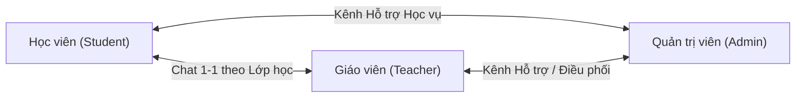
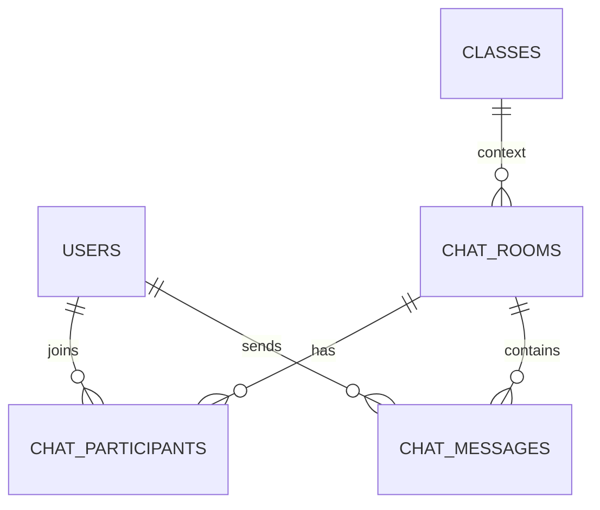

# TÀI LIỆU PHÂN TÍCH & THIẾT KẾ HỆ THỐNG CHAT NỘI BỘ (`#lms-chat-fab`)

**Dự án:** LMS MasterStudy — Trung tâm Ngoại ngữ AROMA  
**Phạm vi:** Cả 3 Portal (`Admin`, `Teacher`, `Student`)  
**Tham chiếu thiết kế:**
- `Tai-lieu-phat-trien/student-ver2/cửa sổ chat.png`
- `Tai-lieu-phat-trien/teacher/Tổng quan - Nút chat.png`
- `Tai-lieu-phat-trien/teacher/Chi tiết lớp nhóm - Lộ trình và Danh sách học viên.png` (ghi chú: `** icon chat với học viên`)
- Mã nguồn hiện tại: `lms/lib/lms_layout.php` (`#lms-chat-fab`, `#lms-chat-popover`), `lms/public/js/lms-notif.js`

---

## 1. Phân tích Mockup & Bối cảnh Nghiệp vụ (Giả định & Rủi ro)

### 1.1. Bóc tách Mockup thiết kế (`cửa sổ chat.png`)
Trong ảnh thiết kế mẫu, giao diện sử dụng bố cục của khung Shopee Web Chat làm khung sườn (wireframe), cụ thể:
- **Phần giữ lại theo đúng nghiệp vụ LMS:**
  - Nút nổi `#lms-chat-fab` ở góc dưới bên phải màn hình trên mọi trang của LMS.
  - Khung cửa sổ nổi (Popup/Dock Window) chia 2 cột:
    - **Header:** Tiêu đề `Chat (N)` màu cam `#F26B2A` hiển thị số hội thoại chưa đọc, cùng nút thu gọn cột trái `[→]` và nút hạ cửa sổ `[⌄]`.
    - **Cột trái (Danh sách hội thoại):** Ô tìm kiếm theo tên + bộ lọc `Tất cả / Chưa đọc`; danh sách người liên hệ kèm avatar, tên, ngày/giờ, đoạn trích tin nhắn cuối và nhãn trạng thái màu đỏ (`Đã bị khóa`).
    - **Cột phải (Khung hội thoại chính):** Tiêu đề người đang trò chuyện; luồng tin nhắn (tin nhắn đến nền trắng `#ffffff` bên trái, tin nhắn đi nền vàng kem `#fdf4dc` bên phải kèm thời gian `HH:mm`); khung nhập tin nhắn và thanh công cụ đính kèm.
  - Điểm chạm từ màn hình nghiệp vụ: Tại màn hình **Chi tiết lớp nhóm** của Giáo viên (`Chi tiết lớp nhóm - Lộ trình và Danh sách học viên.png`), cột Hành động trong bảng Danh sách học viên có **icon chat với học viên** để mở trực tiếp cửa sổ chat với học viên đó.

- **Phần dữ liệu giả lập từ Shopee mẫu cần loại bỏ / chuẩn hóa sang LMS:**
  - Tên các gian hàng mẫu (*DANYCASE, ANENG, Top1k.sale...*), nhãn *Đông lạnh*, cảnh báo giao dịch ngoài Shopee, hoặc tính năng gửi thẻ Sản phẩm/GPKD không thuộc nghiệp vụ giáo dục và sẽ được thay bằng thông tin **Giáo viên / Học viên / Lớp học / Ban Giáo vụ (Admin)**.

### 1.2. Các rủi ro kỹ thuật & nghiệp vụ cần kiểm soát
1. **Rủi ro phân quyền giao tiếp (Ai được phép nhắn tin cho ai?):**
   - Nếu cho phép tìm kiếm tự do toàn bộ bảng `db_lms_users`, học viên có thể nhắn tin cho học viên khác hoặc giáo viên không dạy mình, gây mất kiểm soát nội dung.
   - **Giải pháp:** Bắt buộc kiểm soát quyền mở hội thoại dựa trên quan hệ lớp học (`db_lms_classes` + `db_lms_class_students`) và kênh hỗ trợ Admin.
2. **Rủi ro dung lượng máy chủ khi đính kèm tệp:**
   - Thanh công cụ trong ảnh có icon gửi Video. Nếu cho phép upload video qua chat trên máy chủ PHP/MySQL sẽ nhanh chóng làm đầy ổ cứng và nghẽn băng thông.
   - **Giải pháp:** Chỉ hỗ trợ **Văn bản (Text) + Emoji + Hình ảnh (JPG/PNG/WEBP) + Tài liệu học tập (PDF/DOCX/XLSX ≤ 10MB)** thông qua helper `lms_save_files()` sẵn có; lược bỏ nút gửi video.
3. **Ý nghĩa nghiệp vụ của nhãn `Đã bị khóa`:**
   - Khi tài khoản đối phương bị khóa (`users.status = 'locked'`), hoặc toàn bộ các lớp học chung giữa Giáo viên và Học viên đã kết thúc/hủy (`classes.status IN ('finished', 'cancelled')`), hoặc học viên đã chuyển lớp (`class_students.status = 'transferred_out'`), cuộc hội thoại được gắn nhãn **`Đã bị khóa`**.
   - Ở trạng thái này, người dùng vẫn **xem lại được lịch sử tin nhắn cũ** để tra cứu nhưng **không thể gửi tin nhắn mới** (khung nhập chuyển sang trạng thái read-only).

---

## 2. Phân tích Hạ tầng & Lựa chọn Công nghệ Realtime (WebSocket vs AJAX)

### 2.1. Tại sao WebSocket tự dựng phức tạp trên nền tảng PHP 7.3 hiện tại?
Nếu sử dụng WebSocket tự dựng bằng PHP (Ratchet / Workerman), hệ thống sẽ phát sinh 4 rào cản hạ tầng:
1. **Phụ thuộc bắt buộc vào VPS / Dedicated Server:**
   - PHP truyền thống chạy theo chu kỳ *Request – Response* ngắn hạn, trong khi WebSocket cần **1 tiến trình chạy ngầm liên tục 24/7 (Daemon)**.
   - Các gói **Shared Hosting (cPanel/DirectAdmin)** hầu hết chặn quyền chạy daemon và chặn mở cổng (port) tùy chỉnh → không thể triển khai nếu không thuê VPS có quyền root SSH.
2. **Cấu hình SSL/TLS (`wss://`) và Reverse Proxy:**
   - Khi chạy trên tên miền `https://`, trình duyệt bắt buộc kết nối WebSocket phải đi qua `wss://`. Đội vận hành phải cấu hình thêm Apache (`mod_proxy_wstunnel`) hoặc Nginx Reverse Proxy để chuyển tiếp cổng.
3. **Quản lý tiến trình (Process Monitoring) & Rò rỉ bộ nhớ:**
   - Cần cài đặt **Supervisor / Systemd** (Linux) hoặc **Windows Service** để tự động khởi동 lại tiến trình WebSocket nếu bị crash hoặc đứt kết nối MySQL.
4. **Tách biệt xác thực (Session Auth):**
   - Tiến trình WebSocket chạy độc lập với Apache nên không đọc trực tiếp `$_SESSION` theo cách thông thường, đòi hỏi phải xây dựng thêm cơ chế cấp phát & xác thực One-time Token / JWT.

### 2.2. Bảng so sánh 3 phương án truyền tải

| Tiêu chí | Phương án 1: Tự dựng WebSocket (Ratchet / Workerman) | Phương án 2: WebSocket Đám mây (Pusher / Ably) | Phương án 3: Smart AJAX Short-Polling (Khuyến nghị) |
|---|---|---|---|
| **Yêu cầu Server** | **Bắt buộc VPS/Server riêng** (root SSH, Supervisor, mở port, Reverse Proxy SSL). | **Không cần cấu hình server.** Chạy được trên cả Shared Hosting & Laragon. | **Không cần cấu hình server.** Tương thích 100% môi trường PHP 7.3 + Apache hiện tại. |
| **Cơ chế hoạt động** | Trình duyệt giữ kết nối TCP tới daemon PHP qua cổng riêng. | Gửi tin qua PHP POST → lưu MySQL → PHP gọi HTTP sang Pusher để đẩy sự kiện về trình duyệt. | Khi đóng chat: poll nhẹ số tin chưa đọc (30s/lần). Khi mở khung chat: poll tin nhắn mới (`id > after_id`) mỗi 3–4s; tự dừng khi ẩn tab (`document.hidden`). |
| **Chi phí & Phụ thuộc** | Tốn công vận hành hệ thống (DevOps). | Phụ thuộc dịch vụ bên thứ 3 (gói Free giới hạn 100 kết nối đồng thời, 200k msg/ngày). | **Miễn phí 100%**, tự chủ hoàn toàn, không phụ thuộc bên ngoài. |
| **Độ phức tạp triển khai** | **Cao** (gấp 3–4 lần so với HTTP thuần). | **Trung bình - Thấp**. | **Thấp nhất** (đồng bộ hoàn toàn với cơ chế của `lms-notif.js` đang chạy). |

### 2.3. Định hướng kiến trúc "Plug-and-Play" (Sẵn sàng nâng cấp)
- **Giai đoạn hiện tại:** Triển khai theo **Phương án 3 (Smart AJAX Short-Polling)** để đảm bảo chạy ổn định ngay trên cả Laragon lẫn mọi môi trường Hosting/VPS mà không cần cài thêm dịch vụ ngầm. Với truy vấn theo chỉ mục `WHERE room_id = ? AND id > ?`, MySQL xử lý dưới `2ms`.
- **Khả năng mở rộng tương lai:** Toàn bộ logic nhận tin nhắn mới ở Frontend được gom vào hàm chuẩn `LMS.chat.appendIncomingMessages(messages)`. Nếu sau này hệ thống chuyển lên VPS lớn và muốn gắn thêm Pusher hoặc WebSocket, chỉ cần đẩy sự kiện vào hàm này mà **không phải sửa đổi Database hay Backend Service**.

---

## 3. Ma trận Phân quyền Giao tiếp (Access Control Matrix)



| Người gửi \ Người nhận | Học viên (Student) | Giáo viên (Teacher) | Quản trị viên (Admin) |
|---|---|---|---|
| **Học viên (Student)** | ❌ **Cấm** (Học viên không chat với nhau) | ✅ **Chỉ GV dạy lớp của mình** (Khoá gửi nếu lớp đã kết thúc/chuyển lớp) | ✅ **Cho phép** (Qua phòng Hỗ trợ Học vụ) |
| **Giáo viên (Teacher)** | ✅ **Chỉ HV thuộc lớp mình dạy** (Khoá gửi nếu lớp đã kết thúc/HV chuyển đi) | ❌ **Cấm** | ✅ **Cho phép** (Qua phòng Hỗ trợ / Điều phối) |
| **Quản trị viên (Admin)** | ✅ **Cho phép** (Mọi học viên) | ✅ **Cho phép** (Mọi giáo viên) | ✅ **Cho phép** (Cùng trực kênh hỗ trợ) |

**Quy tắc khóa hội thoại (`is_locked = true`, hiển thị nhãn đỏ `Đã bị khóa`):**
1. Tài khoản đối phương có `db_lms_users.status != 'active'`.
2. Giữa Giáo viên và Học viên không còn bất kỳ lớp học chung nào thỏa mãn đồng thời:
   - `db_lms_classes.status IN ('arranging', 'active', 'paused')` và `deleted_at IS NULL`
   - `db_lms_class_students.status = 'active'`

---

## 4. Thiết kế Cơ sở Dữ liệu (Database Schema)

Tuân thủ quy ước của `ERD_MasterStudy.md` v2.1: Prefix `db_lms_`, engine `InnoDB`, charset `utf8mb4_unicode_ci`, khóa chính `BIGINT UNSIGNED`, dùng `VARCHAR(30)` thay `ENUM`, `DATETIME` thay `TIMESTAMP`.



### 4.1. Bảng `db_lms_chat_rooms` (Phòng hội thoại)
Lưu thông tin cuộc hội thoại (hỗ trợ cả chat 1-1 giữa GV–HV và kênh Hỗ trợ Admin).

```sql
CREATE TABLE `db_lms_chat_rooms` (
    `id`              BIGINT UNSIGNED NOT NULL AUTO_INCREMENT,
    `room_type`       VARCHAR(30)  NOT NULL DEFAULT 'direct'
                      COMMENT 'direct (GV-HV, Admin-User 1-1) | support (User-Ban Giáo vụ)',
    `direct_key`      VARCHAR(64)  NOT NULL
                      COMMENT 'Unique key chống tạo trùng phòng: VD direct:5:12 (min_id:max_id) hoặc support:12',
    `class_id`        BIGINT UNSIGNED NULL
                      COMMENT 'Ngữ cảnh lớp học gần nhất (nếu là hội thoại GV-HV)',
    `last_message_id` BIGINT UNSIGNED NULL,
    `last_message_at` DATETIME     NULL,
    `created_at`      DATETIME     NOT NULL DEFAULT CURRENT_TIMESTAMP,
    `updated_at`      DATETIME     NOT NULL DEFAULT CURRENT_TIMESTAMP ON UPDATE CURRENT_TIMESTAMP,
    PRIMARY KEY (`id`),
    UNIQUE KEY `uniq_chat_direct_key` (`direct_key`),
    KEY `idx_chat_room_last_msg` (`last_message_at`),
    KEY `idx_chat_room_class` (`class_id`),
    CONSTRAINT `fk_chat_room_class` FOREIGN KEY (`class_id`)
        REFERENCES `db_lms_classes` (`id`) ON DELETE SET NULL ON UPDATE CASCADE
) ENGINE=InnoDB DEFAULT CHARSET=utf8mb4 COLLATE=utf8mb4_unicode_ci;
```

### 4.2. Bảng `db_lms_chat_participants` (Thành viên trong hội thoại)
Quản lý người tham gia và con trỏ đọc tin nhắn (`last_read_message_id`) giúp đếm số tin chưa đọc cực nhanh mà không cần update hàng loạt trên bảng messages.

```sql
CREATE TABLE `db_lms_chat_participants` (
    `id`                   BIGINT UNSIGNED NOT NULL AUTO_INCREMENT,
    `room_id`              BIGINT UNSIGNED NOT NULL,
    `user_id`              BIGINT UNSIGNED NOT NULL,
    `last_read_message_id` BIGINT UNSIGNED NULL,
    `last_read_at`         DATETIME        NULL,
    `is_muted`             TINYINT(1)      NOT NULL DEFAULT 0,
    `created_at`           DATETIME        NOT NULL DEFAULT CURRENT_TIMESTAMP,
    `updated_at`           DATETIME        NOT NULL DEFAULT CURRENT_TIMESTAMP ON UPDATE CURRENT_TIMESTAMP,
    PRIMARY KEY (`id`),
    UNIQUE KEY `uniq_chat_room_user` (`room_id`, `user_id`),
    KEY `idx_chat_part_user_read` (`user_id`, `last_read_message_id`),
    CONSTRAINT `fk_chat_part_room` FOREIGN KEY (`room_id`)
        REFERENCES `db_lms_chat_rooms` (`id`) ON DELETE CASCADE ON UPDATE CASCADE,
    CONSTRAINT `fk_chat_part_user` FOREIGN KEY (`user_id`)
        REFERENCES `db_lms_users` (`id`) ON DELETE CASCADE ON UPDATE CASCADE
) ENGINE=InnoDB DEFAULT CHARSET=utf8mb4 COLLATE=utf8mb4_unicode_ci;
```

### 4.3. Bảng `db_lms_chat_messages` (Nội dung tin nhắn)
Lưu toàn bộ tin nhắn văn bản và tệp đính kèm.

```sql
CREATE TABLE `db_lms_chat_messages` (
    `id`           BIGINT UNSIGNED NOT NULL AUTO_INCREMENT,
    `room_id`      BIGINT UNSIGNED NOT NULL,
    `sender_id`    BIGINT UNSIGNED NOT NULL,
    `message_type` VARCHAR(30)     NOT NULL DEFAULT 'text'
                   COMMENT 'text | image | file | system',
    `body`         TEXT            NULL,
    `attachments`  JSON            NULL
                   COMMENT 'Mảng [{name, url, mime, size}] lưu qua lms_save_files()',
    `created_at`   DATETIME        NOT NULL DEFAULT CURRENT_TIMESTAMP,
    `deleted_at`   DATETIME        NULL,
    PRIMARY KEY (`id`),
    KEY `idx_chat_msg_room_id` (`room_id`, `id`),
    KEY `idx_chat_msg_sender` (`sender_id`),
    CONSTRAINT `fk_chat_msg_room` FOREIGN KEY (`room_id`)
        REFERENCES `db_lms_chat_rooms` (`id`) ON DELETE CASCADE ON UPDATE CASCADE,
    CONSTRAINT `fk_chat_msg_sender` FOREIGN KEY (`sender_id`)
        REFERENCES `db_lms_users` (`id`) ON DELETE RESTRICT ON UPDATE CASCADE
) ENGINE=InnoDB DEFAULT CHARSET=utf8mb4 COLLATE=utf8mb4_unicode_ci;
```

---

## 5. Thiết kế Kiến trúc Backend & API Endpoints

### 5.1. Service Layer: `lms/services/Lms/ChatService.php`
Kế thừa `LmsService`, cung cấp các phương thức nghiệp vụ:
1. **`canUsersChat(int $userA, int $userB): array`**
   - Kiểm tra vai trò của 2 user và trả về `['allowed' => bool, 'is_locked' => bool, 'lock_reason' => string, 'class_id' => ?int, 'subtitle' => string]`.
2. **`getOrCreateDirectRoom(int $userId, int $targetUserId): ?array`**
   - Sinh `direct_key = 'direct:' . min($u1, $u2) . ':' . max($u1, $u2)`.
   - Dùng transaction tạo phòng (nếu chưa có) và thêm 2 dòng vào `db_lms_chat_participants`.
3. **`listRoomsForUser(int $userId, string $filter = 'all', string $keyword = ''): array`**
   - Đồng bộ danh bạ hợp lệ (tự động hiển thị các GV/HV cùng lớp active và kênh Hỗ trợ Admin ngay cả khi chưa nhắn tin lần nào, hoặc tìm kiếm trực tiếp trong danh sách đối tác hợp lệ).
   - Tính số tin chưa đọc cho từng phòng: `COUNT(m.id) WHERE m.room_id = r.id AND m.id > COALESCE(p.last_read_message_id, 0) AND m.sender_id != $userId`.
   - Trả về danh sách phòng sắp xếp theo `COALESCE(last_message_at, created_at) DESC`.
4. **`listMessages(int $roomId, int $userId, int $afterId = 0, int $beforeId = 0, int $limit = 30): array`**
   - Kiểm tra row-level: `$userId` phải tồn tại trong `db_lms_chat_participants` của `$roomId`.
   - Nếu `$afterId > 0`: Lấy các tin nhắn mới (`id > $afterId`).
   - Nếu `$beforeId > 0`: Tải thêm lịch sử cũ khi cuộn lên (`id < $beforeId`).
5. **`sendMessage(int $roomId, int $senderId, string $body, array $attachments = []): array`**
   - Kiểm tra quyền thành viên và trạng thái `!$is_locked`.
   - Insert vào `db_lms_chat_messages`, cập nhật `last_message_id`, `last_message_at` ở `db_lms_chat_rooms`, và cập nhật `last_read_message_id` cho chính người gửi.
6. **`markRoomRead(int $roomId, int $userId): void`**
   - Cập nhật `last_read_message_id = room.last_message_id`, `last_read_at = NOW()`.

### 5.2. Module Ẩn & Endpoints AJAX: `lms-chat`
Tương tự module ẩn `lms-thong-bao` (`lms/lib/lms_notif_page.php`), tạo file dùng chung `lms/lib/lms_chat_page.php` và require từ `lms/app/<portal>/sources/lms-chat.php` ở cả 3 portal:

| Action (`?a=...`) | Method | Bảo mật | Tham số | Phản hồi JSON |
|---|---|---|---|---|
| `unread_summary` | `GET` | Auth Gate | — | `{ ok: true, unread_rooms: N, unread_messages: M }` (dùng cho badge trên `#lms-chat-fab`) |
| `rooms` | `GET` | Auth Gate | `q`, `filter` (`all`\|`unread`) | `{ ok: true, unread_rooms: N, rooms: [...] }` |
| `messages` | `GET` | Auth Gate + Row-level | `room_id`, `after_id`, `before_id` | `{ ok: true, room: {...}, messages: [...] }` |
| `open_with` | `POST` | Auth Gate + CSRF | `target_user_id` | `{ ok: true, room_id: X }` (mở/tạo hội thoại với 1 user cụ thể) |
| `send` | `POST` | Auth Gate + CSRF + Row-level | `room_id`, `body`, `files[]` | `{ ok: true, message: {...} }` |
| `mark_read` | `POST` | Auth Gate + CSRF + Row-level | `room_id` | `{ ok: true, unread_rooms: N }` |

---

## 6. Thiết kế Giao diện & Trải nghiệm Người dùng (Frontend UI/UX)

### 6.1. Cấu trúc HTML trong `lms/lib/lms_layout.php`
Thay thế `#lms-chat-popover` placeholder hiện tại bằng cấu trúc chuẩn:
- **Nút nổi `#lms-chat-fab`:** Có thêm `<span class="lms-chat-fab-badge" id="lms-chat-fab-badge" hidden>0</span>`.
- **Khung cửa sổ `#lms-chat-window`:**
  - `.lms-chat-header`: Tiêu đề `Chat (<span id="lms-chat-header-count">0</span>)` + nút thu gọn danh sách trái (`#lms-chat-toggle-sidebar`) + nút thu nhỏ cửa sổ (`#lms-chat-minimize`).
  - `.lms-chat-body`:
    - **Cột trái (`.lms-chat-sidebar`):**
      - Thanh tìm kiếm `#lms-chat-search` + Dropdown lọc `#lms-chat-filter` (`Tất cả` / `Chưa đọc`).
      - Danh sách cuộc hội thoại `#lms-chat-room-list`.
    - **Cột phải (`.lms-chat-main`):**
      - `.lms-chat-conv-header`: Tên đối phương + tên lớp/vai trò.
      - `.lms-chat-messages` (`#lms-chat-messages`): Vùng cuộn tin nhắn (tự động render ngày phân cách và bong bóng tin nhắn trái/phải).
      - `.lms-chat-composer` (`#lms-chat-composer`):
        - Khung preview tệp đính kèm (nếu có chọn ảnh/file trước khi bấm gửi).
        - `<textarea id="lms-chat-input" placeholder="Nhập nội dung tin nhắn..."></textarea>`
        - Thanh công cụ dưới: Nút chọn Emoji cơ bản, Nút chọn Ảnh (`accept="image/*"`), Nút chọn Tệp (`accept=".pdf,.doc,.docx,.xls,.xlsx"`), và Nút Gửi (`#lms-chat-send-btn`).
      - `.lms-chat-locked-bar` (`#lms-chat-locked-bar`, ẩn mặc định): Hiện thông báo khi cuộc hội thoại có `is_locked = true`.

### 6.2. Cơ chế hoạt động của `lms/public/js/lms-chat.js`
1. **Khởi tạo nhẹ (Lazy Load):**
   - Khi vừa tải trang, chưa tải toàn bộ danh sách tin nhắn để tiết kiệm tài nguyên; chỉ lấy `unread_summary` để hiển thị số đỏ trên nút `#lms-chat-fab`.
2. **Khi nhấn `#lms-chat-fab`:**
   - Mở `#lms-chat-window`, gọi `GET .../lms-chat/rooms` để render cột trái và tự động mở cuộc hội thoại gần nhất ở cột phải.
   - Bật bộ đếm `setInterval` (3.5 giây/lần) gọi `GET .../lms-chat/messages?room_id=X&after_id=lastMsgId` **chỉ khi cửa sổ chat đang mở và tab trình duyệt đang hiển thị (`!document.hidden`)**.
3. **API toàn cục để gọi từ các màn hình khác (`LMS.chat.openWithUser(userId)`):**
   - Tại bảng học viên lớp nhóm của Giáo viên (`Chi tiết lớp nhóm - Lộ trình và Danh sách học viên.png`) hoặc thẻ lớp học, nút icon chat chỉ cần khai báo:
     ```html
     <button type="button" class="btn btn-sm btn-outline-primary" data-lms-chat-user="<?= (int) $student['user_id'] ?>">
         <i class="fa-regular fa-comment-dots"></i>
     </button>
     ```
   - `lms-chat.js` bắt sự kiện click `[data-lms-chat-user]`, gọi `POST .../lms-chat/open_with`, bật cửa sổ chat và focus thẳng vào ô nhập tin nhắn với học viên đó.

---

## 7. Lộ trình Triển khai Đề xuất (Implementation Roadmap)

| Giai đoạn | Hạng mục công việc | File liên quan |
|---|---|---|
| **Bước 1: Database & Quyền** | - Tạo file migration SQL cho 3 bảng `db_lms_chat_rooms`, `db_lms_chat_participants`, `db_lms_chat_messages`.<br>- Đăng ký module ẩn `lms-chat` vào `db_lms_modules` và cấp quyền `can_view = 1` cho cả 3 role (`admin`, `teacher`, `student`). | `database/migrations/2026_11_05_lms_chat.sql` |
| **Bước 2: Backend Service & Endpoints** | - Xây dựng `ChatService.php` xử lý kiểm tra quyền theo lớp học, tạo phòng idempotent, gửi/nhận tin nhắn và upload tệp đính kèm.<br>- Tạo `lms/lib/lms_chat_page.php` và 3 file source `lms/app/<portal>/sources/lms-chat.php`. | `lms/services/Lms/ChatService.php`<br>`lms/lib/lms_chat_page.php`<br>`lms/app/*/sources/lms-chat.php` |
| **Bước 3: Giao diện Cửa sổ Chat (`#lms-chat-fab`)** | - Cập nhật HTML trong `lms_layout.php` theo đúng bố cục `cửa sổ chat.png`.<br>- Bổ sung CSS vào `lms/public/css/lms.css` (responsive trên cả Desktop & Mobile).<br>- Viết `lms/public/js/lms-chat.js` (tìm kiếm, lọc tất cả/chưa đọc, gửi text/emoji/ảnh/file, smart polling). | `lms/lib/lms_layout.php`<br>`lms/public/css/lms.css`<br>`lms/public/js/lms-chat.js` |
| **Bước 4: Tích hợp Điểm chạm Nghiệp vụ & Kiểm thử** | - Gắn nút `[data-lms-chat-user]` vào danh sách học viên trong trang Giáo viên.<br>- Viết PHPUnit test cho `ChatService` (kiểm tra phân quyền, khóa chat khi kết thúc lớp, đếm tin chưa đọc) và kiểm thử thực tế trên trình duyệt. | `lms/app/teacher/templates/...`<br>`tests/Lms/ChatServiceTest.php` |
